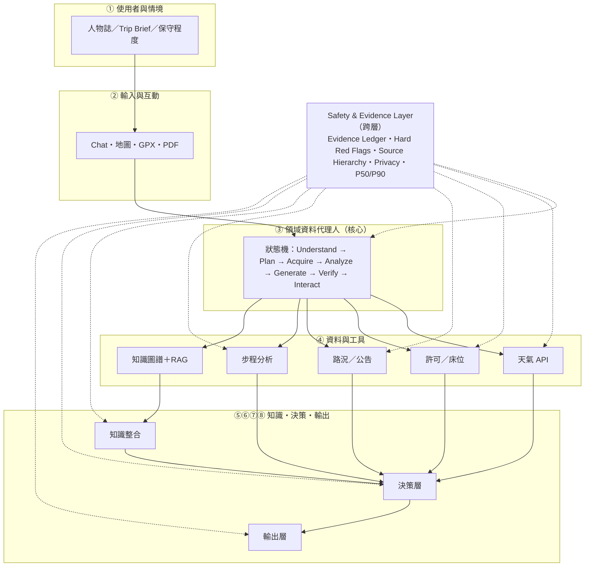
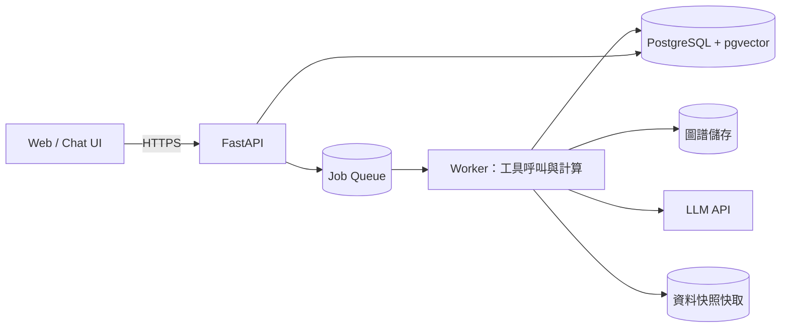
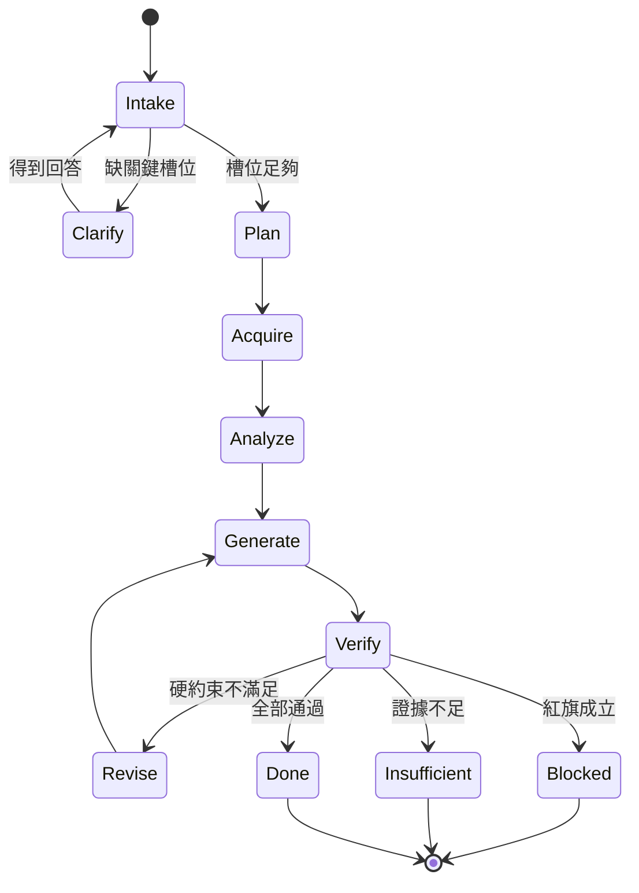
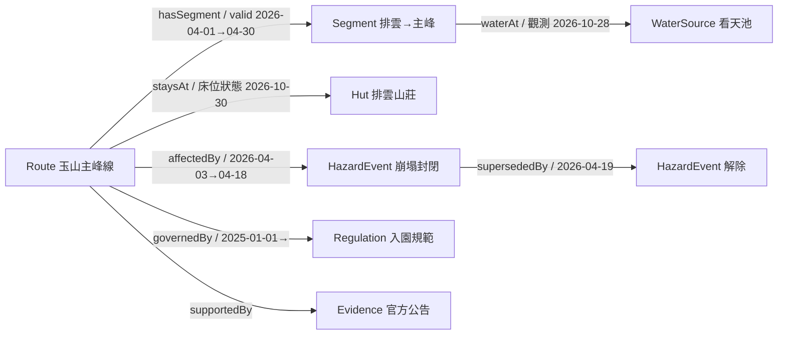

# TrailGuard TW｜系統設計文件（DESIGN.md）

> **專案名稱**：山徑守護者（TrailGuard TW）
> **一句話**：以證據為基礎的臺灣高山行程規劃與風險決策支援代理人。
> **文件版本**：v0.1（Proposal 階段）
> **最後更新**：2026-10-31
> **狀態**：**設計完成、尚未實作、尚未執行實驗**
> **對應文件**：`Proposal_Document.docx`／`Proposal_PPT.pptx`

---

## 0. 給下一位開發者：這份文件怎麼讀

這份文件不是行銷文案，而是**交接文件**。目標是：即使原開發者不在，你也能只靠這份文件 + 程式碼，理解系統為什麼長這樣、每個模組負責什麼、資料從哪來、演算法怎麼算、實驗怎麼跑、以及哪裡還沒做。

**請先接受三個事實：**

1. 目前**沒有任何 agent 程式碼**。本文件描述的是已定案的設計與預定介面（interface contract），不是已完成的功能。
2. 目前**沒有任何實驗結果**。所有數字都是「目標值（target）」或「驗收門檻（acceptance threshold）」，不是量測值。文件與簡報中一律如此標示。
3. 這份文件會隨著實作持續修改。**當設計與程式碼不一致時，以程式碼為準，並回頭修正本文件。**

### 0.1 名詞對照

| 名詞 | 意思 | 不是這個意思 |
|---|---|---|
| Trip Brief | 一次行程的需求摘要（日期、隊伍、路線、限制） | 不是商品訂單 |
| 硬約束（hard constraint） | 不滿足即不可行，不可被其他優點抵銷 | 不是「扣分項目」 |
| 紅旗（red flag） | 具否決權的安全條件，優先於任何分數 | 不是「風險加分項」 |
| Evidence Ledger | 每個數值 claim 的來源、時間、有效期、信心 | 不是一般日誌（log） |
| False-Safe | 實際不安全、系統卻說 GO | 不等於「保守」 |
| P50／P90 | 步程估計的分位數；規劃以 P90 為準 | 不是「平均 + 固定緩衝」 |
| 候選（candidate） | 安全／平衡／進取三個可行計畫 | 不是三個景點清單 |

### 0.2 目前可執行的東西

| 可執行 | 指令 | 產出 |
|---|---|---|
| 產生圖表 | `python assets/build_figures.py` | `assets/fig_*.png` |
| 產生提案文件 | `python assets/build_docx.py` | `Proposal_Document.docx` |
| 產生提案簡報 | `python assets/build_pptx.py` | `Proposal_PPT.pptx` |
| 文件轉 PDF（QA） | `soffice --headless --convert-to pdf --outdir . Proposal_PPT.pptx` | `Proposal_PPT.pdf` |

**不可執行**：`uvicorn app.main:app`、`python scripts/eval.py`。這些是實作後的預定介面，見 §10.2。

---

## 1. Problem（問題）

### 1.1 使用者

| 角色 | 情境 | 目前做法 | 痛點 |
|---|---|---|---|
| 新手自組隊（主要） | 第一次抽玉山／雪山，2–4 人 | 部落格 + 學長姐 + 社群 | 不知道「哪裡該停」，把別人的計畫當自己的 |
| 半經驗自組隊（主要） | 一年 2–5 次百岳 | 多個網站並用、Excel 排行程 | 資訊時效不一致，決策靠印象 |
| 資深領隊（次要） | 帶隊、需向隊員說明風險 | 經驗 + 紙本檢查表 | 缺少可稽核的證據與一致的溝通格式 |

### 1.2 問題定義

> **如何在資料不完整、預報不確定、使用者能力差異大的情況下，產生一份「不會把不該上山的人送上山」的計畫？**

這句話刻意不是問「怎麼生成行程」。生成不難，難的是：**知道什麼時候不該生成、什麼數字不能給、什麼時候要停下來問人。**

### 1.3 失敗模式（我們要防的錯）

| 編號 | 失敗模式 | 例子 | 後果 | 對應設計 |
|---|---|---|---|---|
| F1 | 約束漏檢 | 行程排了封閉步道，只因風景很好 | 違法、受困 | 硬約束檢查（§8.3） |
| F2 | 時效錯誤 | 用去年的水源資訊規劃今年的行程 | 缺水 | 時序知識圖譜（§5.2） |
| F3 | 幻覺數字 | 捏造「這段只要 90 分鐘」 | 摸黑、失溫 | Evidence Ledger（§4.3） |
| F4 | 紅旗漏判 | 颱風警報仍給 CONDITIONAL | 死亡 | 紅旗否決層（§7.5） |
| F5 | 過度保守 | 所有行程都說不要去 | 系統沒人用 | 三個候選 + FSR/FNR 並看（§11.2） |
| F6 | 不可執行 | 行程漂亮但沒有床位、沒有接駁 | 現場崩潰 | 許可與床位為硬約束 |
| F7 | 解釋不可讀 | 給一個 62 分，不說為什麼 | 無法問責 | 風險分解與來源並列（§4.4） |

### 1.4 為什麼現有工具不夠

- **入口網站**管許可、**氣象署**管天氣、**社群**管路況、**上河**管步程——各自只解一段。
- 一般 LLM 會生成「看起來完整」的行程，但 TravelPlanner 的結果顯示：GPT-4 在多重約束下的完全滿足率僅 **0.6%** [R6]。問題不是文筆，是**驗證與責任**。
- 事故統計顯示風險沒有自動下降：2015–2024 年 3,450 件山域事故、迷路占 37% [R1]；2023–2025 年高山型國家公園事故率 0.08–0.09%，約為 2016–2019 年的兩倍 [R2]。

---

## 2. Requirements（需求）

### 2.1 功能需求

| ID | 需求 | 驗收方式 |
|---|---|---|
| FR-01 | 從自然語言擷取 Trip Brief（日期、隊伍、路線、限制、經驗） | 20 句標註句、slot F1 ≥ 0.9 |
| FR-02 | 缺關鍵槽位時**一次只問一個**問題 | 人工檢視 30 個案例 |
| FR-03 | 取得並正規化天氣、許可、床位、路況、GPX | 工具 contract test |
| FR-04 | 產生逐段步程 P50／P90 與敏感度 | golden test（固定輸入固定輸出） |
| FR-05 | 產生逐段天氣窗格與硬門檻判定 | 門檻單元測試 |
| FR-06 | 產生 AMS 風險分級與紅旗 | 規則表測試 + 專家檢視 |
| FR-07 | 產生安全／平衡／進取三個候選 | 每個候選都有可行性與代價 |
| FR-08 | 對每個候選執行硬約束、紅旗、證據三道檢查 | 檢查器可單獨呼叫 |
| FR-09 | 每個數值 claim 都有 evidence_id；否則不輸出 | EGR 量測 |
| FR-10 | 衝突資料並列顯示（官方 vs 社群） | 案例測試 |
| FR-11 | 輸出撤退點、回頭時間、離線緊急卡 | 輸出 schema 檢查 |
| FR-12 | 全程可追溯：誰在什麼時間、用哪個版本算出什麼 | Ledger 匯出 |

### 2.2 非功能需求

| ID | 需求 | 目標 |
|---|---|---|
| NFR-01 | 延遲 | 完整規劃 P95 ≤ 60 秒 |
| NFR-02 | 可解釋 | 任一數字可回溯到來源與版本 |
| NFR-03 | 可重現 | 固定資料快照 + 固定種子 → 相同輸出 |
| NFR-04 | 可降級 | 單一資料源失效時，輸出「資料不足」而非猜測 |
| NFR-05 | 隱私 | 健康資料預設不離開本機；不儲存完整病歷 |
| NFR-06 | 成本 | 單次規劃的 LLM 成本上限（待定，暫定 < US$0.05） |
| NFR-07 | 安全 | 紅旗判定不依賴 LLM |
| NFR-08 | 可維護 | 知識與規則版本化，可回滾 |

### 2.3 硬性 vs 軟性

| 類別 | 例子 | 處理 |
|---|---|---|
| 硬約束 | 封閉步道、未取得許可、床位未中籤、最晚撤退時間 | 不滿足 → 不可行（HOLD／NO-GO／改線） |
| 紅旗 | 颱風、豪雨、雷暴、AMS 神經學症狀 | 直接覆寫，不參與加權 |
| 軟偏好 | 「想住山屋」「不想單攻」「想省錢」 | 進入目標函數，可被取捨 |
| 不確定 | 午後雷雨 40%、步程 P90 | 以機率與區間呈現，不壓成單一數字 |

### 2.4 驗收門檻（目標，非結果）

| 指標 | 定義 | 門檻 |
|---|---|---|
| CSR | 滿足硬性限制／總硬性限制 | ≥ 85% |
| EGR | 有有效來源的數值 claim／總數值 claim | ≥ 95% |
| FSR | 不該 GO 卻給 GO／所有不安全案例 | ≤ 2% |
| 步程 MAE | 預測與實測步程的平均絕對誤差 | ≤ 20% |
| 專家接受度 | 1–5 分 | ≥ 4.0 |
| SUS | 系統使用性量表 | ≥ 75 |
| P95 延遲 | 完整規劃回應時間 | ≤ 60 秒 |

> **重要**：以上全部是**設計目標**。截至 v0.1，一項都還沒有量測。

---

## 3. Architecture（架構）

### 3.1 四層 + 一個跨層



**設計原則**：LLM 不是資料庫，也不是計算器；它是**協調者與解釋者**。每個工具都有 schema，回傳值必附 provenance。

### 3.2 為什麼這樣切

| 決策 | 理由 | 代價 |
|---|---|---|
| LLM 只做理解／規劃／解釋 | 數字與規則必須可重現、可測試 | 需要更多工具與 schema 工程 |
| 計算全部在 Python | 可寫單元測試、可做敏感度分析 | 初期開發較慢 |
| 知識層用時序圖譜 + RAG | 純 RAG 無法回答「這筆還有效嗎」 | 需要資料治理與版本管理 |
| 紅旗獨立成否決層 | 錯誤成本不對稱 | 可能提高 False NO-GO |
| 一次給三個候選 | 把價值判斷交還人類 | 輸出較長、需要比較介面 |

### 3.3 部署視圖（原型）



單機原型可把 Queue 與 Worker 省略，同步執行；但**介面先留好**，避免之後改寫。

### 3.4 狀態機



**四個停下來的地方**（本系統的核心）：缺槽追問、硬限制不滿足、紅旗成立、證據不足。

---

## 4. Components（元件）

### 4.1 模組職責

| # | 模組 | 責任 | 輸入 | 輸出 | 失敗處理 |
|---|---|---|---|---|---|
| ① | 使用者與情境 | 人物誌、保守程度、trip brief | 對話、表單 | `UserProfile` | 預設保守值並標記 |
| ② | 輸入與互動 | NL、地圖、GPX、PDF 解析 | 原始輸入 | 結構化需求 | 解析失敗 → 請使用者重傳 |
| ③ | 領域資料代理人 | 狀態機、工具呼叫、反思 | Trip Brief | 任務圖、候選 | 逾時 → 降級或中止 |
| ④ | 資料取得與檢索 | API、爬蟲、GPX、PDF、社群 | 任務圖 | 原始資料 + metadata | 單源失敗 → 標記缺資料 |
| ⑤ | 分析引擎 | 步程、天氣、AMS、風險、最佳化 | 正規化資料 | 數值 + 不確定性 | 參數缺漏 → 拒絕計算 |
| ⑥ | 知識整合 | Temporal KG + Hybrid RAG | 查詢、資料 | 帶時效的知識卡 | 無結果 → 回報缺口 |
| ⑦ | 決策與建議 | GO／CONDITIONAL／HOLD／NO-GO | 分析結果 | 決策 + 理由 | 紅旗 → 直接覆寫 |
| ⑧ | 輸出與互動 | 儀表板、PDF、離線卡、回饋 | 決策 | 使用者可見輸出 | 渲染失敗 → 純文字 fallback |

### 4.2 工具契約（節錄）

所有工具回傳**一定**包含 `evidence_ids` 與 `assumptions`。沒有 evidence 的數值，生成層不得引用。

```json
{
  "tool": "estimate_hiking_time",
  "version": "tobler-v1.2",
  "input": {
    "route_id": "yushan_main_3d2n",
    "segments": [{"seg_id": "s1", "distance_km": 2.8, "ascent_m": 320, "descent_m": 40, "surface": "rock"}],
    "party": {"size": 3, "fitness": "novice", "load_kg": 11, "altitude_experience": "none"},
    "weather": {"precip_prob": 0.6, "wind_ms": 9, "visibility_m": 800}
  },
  "output": {
    "p50_min": 132,
    "p90_min": 147,
    "per_segment": [{"seg_id": "s1", "p50_min": 78, "p90_min": 88}],
    "drivers": ["坡度 18%", "揹負 11 kg", "午後降雨機率 60%"],
    "assumptions": ["Tobler 基底速度", "休息 10 min/hr", "未計入高山症惡化"],
    "evidence_ids": ["ev_gpx_2026_10_30", "ev_cwa_2026_10_31_0600"]
  }
}
```

### 4.3 Evidence Ledger

每一筆 claim 一列，欄位固定：

| 欄位 | 說明 |
|---|---|
| `evidence_id` | 穩定 ID（來源 + 日期 + 雜湊前綴） |
| `claim` | 被宣稱的項目（步程、床位、路況…） |
| `value` | 值與單位 |
| `source` | 名稱、URL、層級（official／peer-reviewed／open-data／named-community／anonymous） |
| `observed_at` | 事件實際發生時間 |
| `retrieved_at` | 系統取得時間 |
| `valid_from` / `valid_to` | 有效期間（`null` 表示未知或持續有效） |
| `superseded_by` | 被哪一筆取代 |
| `confidence` | 0–1，依來源層級與新鮮度 |
| `hash` | 原始內容雜湊，供稽核 |

**四條規則**：

1. 有來源才輸出；沒有 evidence_id 的數值 claim 一律不得進入生成層。
2. 過期就降權並標「待查證」，不直接刪除（刪除會讓系統看起來比實際確定）。
3. 衝突就並列（官方 vs 社群），不自動合併成單一答案。
4. 缺資料就說不知道；不以平均值或 0 補值。

### 4.4 輸出（行前決策包）

- 三個候選（安全／平衡／進取）與各自的代價
- 逐段風險儀表板（時間 × 天氣 × 地形 × 隊伍）
- 撤退點與回頭時間
- 裝備、水源、通訊檢查表
- 離線緊急卡與留守人腳本
- 每個數字的來源與時間戳

---

## 5. Data（資料）

### 5.1 來源清單

| 來源 | 內容 | 更新頻率 | 層級 | 備註 |
|---|---|---|---|---|
| 內政部消防署統計 [R1] | 山域事故件數、原因 | 年 | 官方 | 趨勢與問題定義 |
| 環境資訊中心／國家公園統計 [R2] | 入園人次、事故率、原因 | 年 | 官方／媒體整理 | 需回溯原始統計 |
| 玉山國家公園 [R3] | 入園規範、步道狀況、高山症衛教 | 即時～月 | 官方 | 封閉公告為硬約束 |
| 氣象署 F-D0047-091 [R4] | 鄉鎮逐 3 小時預報 | 每 3–6 小時 | 官方 API | 需組時間窗 |
| 政府資料開放平台 [R5] | 步道、山屋、救難點 | 不定 | 官方 | 格式不一 |
| 上河文化 [R7] | 參考步程 | 版次 | 商業出版 | 僅作 baseline，需校正 |
| GPX／具名社群回報 | 軌跡、路況、水源 | 即時～月 | 具名社群 | 只能提示，不能單獨決定 GO |

### 5.2 時序知識圖譜

**10 類實體**：`Route`、`Segment`、`Trailhead`、`Hut`、`WaterSource`、`CommsPoint`、`HazardEvent`、`Regulation`、`Permit`、`Evidence`。

**9 種關聯**：`hasSegment`、`startsAt`、`staysAt`、`waterAt`、`commsAt`、`affectedBy`、`governedBy`、`supersededBy`、`supportedBy`。

**每條邊都帶五個時間欄位**：`observed_at`、`retrieved_at`、`valid_from`、`valid_to`、`superseded_by`。



**查詢範例**：

- 「排雲山莊現在還有床位嗎？」→ 取 `staysAt` 邊中 `retrieved_at` 最新者，檢查 `valid_to`。
- 「這條路封閉解除了嗎？」→ 找 `HazardEvent`，沿 `supersededBy` 找最新狀態。
- 「這個水源可靠嗎？」→ 看 `observed_at` 與 `confidence`，並顯示資料年齡。

### 5.3 資料治理

| 規則 | 做法 |
|---|---|
| 來源階層 | official > peer-reviewed > open-data > named-community > anonymous |
| 有效期 | 每筆資料強制填 `retrieved_at`；能填 `valid_to` 就填 |
| 衝突 | 保留雙方，UI 並列，不自動合併 |
| 缺資料 | 輸出「資料不足」與替代查詢，不以 0 或平均補 |
| 版本 | 知識與規則皆有 `version`，可回滾 |
| 快照 | 每次規劃保存資料快照 ID，供重現 |

### 5.4 快取與時效

| 資料 | TTL | 理由 |
|---|---|---|
| 天氣預報 | 3 小時 | 來源更新頻率 |
| 步道封閉 | 30 分鐘 | 安全關鍵 |
| 山屋床位 | 1 小時 | 變動快但非秒級 |
| 步程 baseline | 永久（版控） | 不會即時變動 |
| 社群路況 | 24 小時 | 需人工覆核 |

### 5.5 隱私

- 健康資訊（病史、用藥、SpO₂）預設只存在本機 session，不進 LLM context 的原始文字。
- 需要模型推理時，只傳去識別化的結構化特徵（例如 `prior_ams: true`）。
- 可匯出／刪除個資；Ledger 保存去識別化後的 evidence，不保存對話全文。

---

## 6. AI / Analytics（模型與分析）

### 6.1 LLM 的角色

| 做 | 不做 |
|---|---|
| 聽懂需求、追問缺槽 | 產生步程數字 |
| 拆解任務、選擇工具 | 決定紅旗是否成立 |
| 把計算結果轉成可讀說明 | 修改工具回傳值 |
| 比較三個候選的代價 | 保證安全 |

### 6.2 推理策略

- **結構化輸出**：所有工具呼叫以 JSON schema 約束（Pydantic）。
- **ReAct 式循環**：`Thought → Action → Observation`，但**最多 8 步**，超過即中止並回報。
- **決定性參數**：`temperature=0`（或低溫），固定 seed；工具計算不用 LLM。
- **模型分層**：規劃用較強模型；摘要與格式轉換用較小模型以降低成本。

### 6.3 RAG 管線


**關鍵**：檢索前先過濾時效；生成後再稽核引用。這兩步是「No source, no number」的落地方式。

### 6.4 分析引擎

| 模組 | 方法 | 輸出 |
|---|---|---|
| 步程 | Tobler 坡度速度 + 個人化校正 + 蒙地卡羅 | P50／P90、逐段時間、敏感度 |
| 天氣窗格 | 逐段時間窗加權風險 + 硬門檻 | 每段風險分數與可否通行 |
| AMS | Lake Louise 評分卡 + 邏輯迴歸（進階） | 四級風險 + 紅旗 |
| 路線風險 | 地形暴露、墜落、迷路、通訊、水源 | 逐段風險分解 |
| 最佳化 | OR-Tools CP-SAT／啟發式 | 三個 Pareto 候選 |

### 6.5 Prompt 原則

1. **角色**：你是行程規劃的協調者，不是醫療或安全保證人。
2. **證據**：只能引用工具回傳的數字；每個數字附 `evidence_id`。
3. **不確定**：用區間與機率，不用「應該沒問題」。
4. **停下來**：缺資料、紅旗、硬約束不滿足時，明確說出並停止。
5. **不做醫療診斷**：只做辨識與就醫／撤退建議，不給藥物劑量。

System prompt 草稿見 `app/prompts/system.md`（預定路徑，尚未建立）。

### 6.6 防護與失敗處理

| 情況 | 行為 |
|---|---|
| 工具逾時 | 重試 1 次；仍失敗 → 標記該資料缺，降級輸出 |
| 工具回傳格式錯誤 | 拒絕使用，記錄 `tool_error`，不讓 LLM 自行補值 |
| LLM 產生未引用數字 | 稽核器刪除該句或標記「未經證實」 |
| 幻覺來源 | 檢查 `evidence_id` 是否存在；不存在即丟棄 |
| 迴圈超過上限 | 中止，回報已完成部分與缺口 |

---

## 7. Domain Knowledge（領域知識）

### 7.1 步程

Tobler 的坡度速度函數（健行）：

```
W = 6 · exp(−3.5 · |S + 0.05|)      # km/h，S 為坡度（上升為正）
T_base = Σ (distance_i / W_i)
```

個人化與情境校正：

```
T_hat = T_base × f_fitness × f_load × f_weather × f_altitude
```

- `f_fitness`：由自述體能與過去紀錄估計（1.0–1.4）
- `f_load`：揹負重量（每 +5 kg 約 +5–8%）
- `f_weather`：雨、雪、泥濘、夜間
- `f_altitude`：>3,000 m 的下降與休息增加

以蒙地卡羅抽樣參數，輸出 P50／P90；**規劃用 P90**。上河步程僅作 baseline，不用作承諾 [R7]。

### 7.2 天氣門檻

| 條件 | 判定 |
|---|---|
| 颱風警報、豪雨特報 | NO-GO／延期 |
| 雷暴機率 ≥ 40% 且行程在暴露段 | 調整時間窗或折返 |
| 陣風 > 15 m/s | 暴露段 NO-GO |
| 能見度 < 500 m | 高風險；不建議進入非標示路段 |
| 積雪／結冰（非雪季裝備） | NO-GO |

加權風險（僅用於溝通，不用於覆寫紅旗）：

```
W = max_t [0.35·P_precip + 0.25·P_thunder + 0.20·wind_norm + 0.20·vis_norm]
```

### 7.3 高山症（AMS）

- 玉山國家公園衛教指出，超過 **25%** 的玉山登山者符合 AMS 診斷 [R3]。
- 採 Lake Louise 評分（頭痛 + 腸胃、疲倦、頭暈、睡眠障礙）做分級 [R8]。
- **紅旗**（任一即立即下降／求救）：步態不穩、休息時呼吸困難、意識改變、咳血。
- 系統**不給藥物劑量**，只給「停止上升／下降／就醫」的層級建議。

### 7.4 路線風險因子

| 因子 | 來源 | 用途 |
|---|---|---|
| 坡度與暴露 | DEM + GPX | 步程、墜落風險 |
| 地形類型 | 官方步道分級 | 裝備與時間 |
| 通訊點 | 官方／社群 | 緊急應變 |
| 水源 | 官方／社群 | 補水規劃 |
| 撤退點 | 路線知識 + 地形 | 回頭時間 |
| 崩坍／封閉 | 官方公告 | 硬約束 |

### 7.5 紅旗規則（節錄）

| 類別 | 條件 | 動作 |
|---|---|---|
| 氣象 | 颱風、豪雨、雷暴、陣風 >15 m/s | NO-GO／延期 |
| 封閉 | 步道封閉、崩塌、地震後管制 | NO-GO／改線 |
| 醫療 | 步態不穩、休息時呼吸困難、意識改變 | 立即下降、求救 |
| 許可 | 未取得入園／入山、山屋未中籤 | HOLD／替代 |
| 裝備 | 缺保暖、雨具、頭燈、離線地圖 | CONDITIONAL |

**紅旗不參與加權**：任一成立，直接覆寫分數。這是 FSR 能不能壓下來的關鍵。

### 7.6 知識來源與版本

| 類型 | 來源 | 版本策略 |
|---|---|---|
| 法規／許可 | 國家公園、警政署 | 公告日 + 生效日 |
| 醫學 | WMS 指引、Lake Louise | 指引版次 |
| 步程 | Tobler、上河、GPX | 模型版次 + 資料快照 |
| 路況 | 官方公告、社群 | 觀測時間 + 有效期間 |

---

## 8. Algorithm（演算法）

### 8.1 主流程

```
Algorithm 1: Evidence-Grounded Trip Planning Agent
Input : user query Q, profile U, dates D
Output: candidate plans P, risk report R, ledger E

01  intent, slots ← parse_and_link(Q, U, D)
02  if missing_critical_slots:
03      ask_one_question_at_a_time(slots); return
04  task_graph ← decompose(intent, slots)
05  data ← parallel_acquire(task_graph, sources)
06  data ← normalize_and_validate(data)
07  knowledge ← hybrid_retrieve(task_graph, data, KG, KB)
08  T ← estimate_hiking_time(data, U, knowledge)
09  W ← compute_weather_windows(data, T)
10  A ← screen_ams_risk(U, data, knowledge)
11  Route ← decompose_route_risk(data, W, A, U)
12  P ← optimize_itineraries(T, W, A, Route, constraints)
13  for each candidate p in P do
14      V ← verify_hard_constraints(p, data, knowledge)
15      F ← check_red_flags(p, data, knowledge)
16      E ← audit_evidence(p, knowledge)
17      if F.critical then mark NO_GO(p); escalate(p)
18      else if V.nonempty then mark REVISE(p, V)
19      else mark feasible(p, R, E)
20  end for
21  rank feasible candidates by risk, margin, fit
```

### 8.2 風險計算

逐段風險 `R_seg` 由五個因子加權，權重來自專家訪談與敏感度分析（**尚未校準**）：

```
R_seg = w1·terrain + w2·weather + w3·exposure + w4·navigation + w5·party
R_total = Σ (R_seg · duration_seg) / Σ duration_seg
```

權重 `w` 必須記錄版本；任何調整都要重跑回歸測試與敏感度分析。

### 8.3 最佳化

```
min  R_total + λ1·overtime + λ2·cost + λ3·changes
s.t. permit_ok = true
     hut_ok = true
     daylight_margin ≥ 0
     P90(segment) ≤ available_time
     water_capacity ≥ demand
     gear_check = pass
     user_unacceptable = ∅
```

- 硬約束**不是懲罰項**：不滿足就是不可行。
- 以 ε-constraint 或加權掃描產生 Pareto 前緣，取三個代表點：安全、平衡、進取。

### 8.4 證據稽核

```
for each numeric claim c in output:
    ids = c.evidence_ids
    if ids is empty: drop(c) or mark_unverified(c)
    for id in ids:
        if not ledger.exists(id): drop(c)
        if ledger.expired(id): downgrade(c); tag("待查證")
        if ledger.conflict(id): show_both(c)
```

### 8.5 延遲預算（目標）

| 階段 | 預算 |
|---|---|
| 解析與追問 | 3 s |
| 平行取得（含快取） | 8 s |
| 檢索與 rerank | 5 s |
| 計算與最佳化 | 10 s |
| 生成與稽核 | 20 s |
| 緩衝 | 14 s |
| **P95 合計** | **≤ 60 s** |

---

## 9. Implementation Mapping（實作對照）

### 9.1 預定 repo 結構

```
trailguard/
├─ app/
│  ├─ main.py                 # FastAPI 入口
│  ├─ api/routes.py           # /plan /clarify /health
│  ├─ orchestrator/
│  │  ├─ state_machine.py     # §3.4
│  │  └─ policy.py            # 停止條件
│  ├─ agents/planner.py       # LLM 協調
│  ├─ tools/
│  │  ├─ weather.py           # CWA F-D0047-091
│  │  ├─ permits.py           # 入園／山屋
│  │  ├─ trails.py            # 封閉／路況
│  │  ├─ hiking_time.py       # Tobler + 校正 + MC
│  │  ├─ ams.py               # 評分卡
│  │  ├─ risk.py              # 逐段風險
│  │  └─ optimizer.py         # CP-SAT
│  ├─ knowledge/
│  │  ├─ kg.py                # 時序圖譜查詢
│  │  ├─ rag.py               # hybrid retrieve + rerank
│  │  └─ ingest/              # 來源轉接器
│  ├─ evidence/
│  │  ├─ ledger.py
│  │  └─ audit.py
│  ├─ safety/red_flags.py
│  ├─ schemas/                # Pydantic
│  └─ prompts/system.md
├─ data/
│  ├─ raw/                    # 原始快照（不進 git）
│  ├─ processed/
│  ├─ kg/
│  └─ eval/                   # 120 案例
├─ scripts/
│  ├─ ingest.py
│  ├─ build_kg.py
│  └─ eval.py
├─ tests/
│  ├─ unit/
│  ├─ integration/
│  └─ golden/
├─ web/                       # 前端（Next.js 或 Streamlit）
├─ requirements.txt
└─ .env.example
```

### 9.2 元件對照與狀態

| 元件 | 預定路徑 | 狀態 |
|---|---|---|
| 狀態機 | `app/orchestrator/state_machine.py` | 未實作 |
| 天氣工具 | `app/tools/weather.py` | 未實作 |
| 步程工具 | `app/tools/hiking_time.py` | 未實作 |
| AMS 工具 | `app/tools/ams.py` | 未實作 |
| 最佳化 | `app/tools/optimizer.py` | 未實作 |
| 圖譜 | `app/knowledge/kg.py` | 未實作 |
| RAG | `app/knowledge/rag.py` | 未實作 |
| Ledger | `app/evidence/ledger.py` | 未實作 |
| 紅旗 | `app/safety/red_flags.py` | 未實作 |
| 評估腳本 | `scripts/eval.py` | 未實作 |
| 提案文件 | `assets/build_docx.py` | **已完成** |
| 提案簡報 | `assets/build_pptx.py` | **已完成** |

### 9.3 技術選型

| 層 | 選擇 | 理由 |
|---|---|---|
| 語言 | Python 3.11+ | 生態完整、數值與 ML 友善 |
| API | FastAPI + Pydantic | schema 即契約，易測試 |
| 圖譜 | 原型：NetworkX + SQLite；正式：Neo4j | 先求可跑，再求規模 |
| 向量 | pgvector | 與關聯資料同庫，維運簡單 |
| 最佳化 | OR-Tools CP-SAT | 硬約束表達清楚 |
| 前端 | Next.js（或 Streamlit 快速原型） | 地圖與儀表板需求 |
| 測試 | pytest + golden files | 計算可重現 |
| 觀測 | structlog + OpenTelemetry（選用） | 追蹤工具呼叫 |

### 9.4 設定與密鑰

`.env.example`（預定）：

```
LLM_API_KEY=
LLM_MODEL=
CWA_API_KEY=
DATABASE_URL=
MAPBOX_TOKEN=
LOG_LEVEL=INFO
```

**規則**：密鑰不進 git；資料快照不含個資；正式環境用 secret manager。

### 9.5 測試策略

| 類型 | 內容 | 通過標準 |
|---|---|---|
| Unit | Tobler 公式、門檻判定、Ledger 過期 | 固定輸入 → 固定輸出 |
| Contract | 每個工具 JSON schema | schema 驗證通過 |
| Integration | 從 trip brief 到三個候選 | 端到端可跑 |
| Golden | 10 個代表性情境 | 輸出與人工標註一致 |
| Eval | 120 案例 | 見 §11.2 |
| Regression | 每次改權重／規則 | 舊案例不得退步超過閾值 |

### 9.6 里程碑（16 週）

| 週 | 里程碑 | 交付 |
|---|---|---|
| W4 | 知識庫 v1 | 5–8 條路線、來源清單、schema |
| W8 | Agent MVP | 可跑完一次規劃（含 ledger） |
| W12 | 核心實驗 | 120 案例、baselines、指標 |
| W14 | 使用者測試 | SUS、專家訪談 |
| W16 | Final Handover | 程式、README、DESIGN、PPT、影片 |

---

## 10. How to Run

### 10.1 現在可以執行（文件）

```bash
# 1) 產生圖表
python assets/build_figures.py

# 2) 產生 DOCX
python assets/build_docx.py

# 3) 產生 PPTX
python assets/build_pptx.py

# 4) 轉 PDF 檢查版面（需 LibreOffice）
soffice --headless --convert-to pdf --outdir . Proposal_PPT.pptx
```

需求：Python 3.11+、`python-docx`、`python-pptx`、`matplotlib`、`pymupdf`、`Pillow`。

### 10.2 實作後才可用（預定介面）

> 以下指令**目前不存在**，是給下一位開發者的介面約定。

```bash
python -m venv .venv
.venv\Scripts\activate           # Windows
pip install -r requirements.txt
cp .env.example .env             # 填入 API key

# 建知識庫
python scripts/ingest.py --routes data/routes.yaml
python scripts/build_kg.py

# 啟動 API
uvicorn app.main:app --reload --port 8000

# 跑評估
python scripts/eval.py --dataset data/eval/v1 --out results/
```

### 10.3 API 契約（預定）

```http
POST /plan
{ "query": "4/10-4/12 玉山三天兩夜，兩位新手", "profile": {...} }

200 OK
{
  "status": "OK | NEED_CLARIFY | HOLD | NO_GO | INSUFFICIENT",
  "candidates": [...],
  "risk_report": {...},
  "evidence": [...],
  "clarifying_question": null
}
```

### 10.4 常見問題

| 問題 | 處理 |
|---|---|
| 工具一直逾時 | 檢查 API key 與 rate limit；確認快取是否生效 |
| 輸出出現未引用數字 | 執行 `audit`，確認生成層是否繞過工具 |
| 結果不可重現 | 確認 seed、資料快照 ID、模型版本是否固定 |
| PPT 轉 PDF 失敗 | 先關閉所有 `soffice` 程序，再轉檔 |

---

## 11. Results（結果）

### 11.1 目前狀態

**尚未執行任何實驗。** 本節只定義「要怎麼量」與「結果表格長什麼樣」。任何把這裡的數字當成結果的行為，都是誤讀。

### 11.2 評估協定

| 項目 | 設計 |
|---|---|
| 路線 | 30 條臺灣高山／中級山（含玉山、雪山、嘉明湖、奇萊南華等） |
| 人物誌 | 3 種：新手、半經驗、資深領隊 |
| 核心情境 | 30 × 3 = 90 |
| 壓力／對抗 | 30 個（紅旗、資料衝突、缺資料、時間不足） |
| 合計 | 120 |
| 對照組 | GPT-4o zero-shot、GPT-4o + web、RAG-only、人工流程、四個消融 |
| 消融 | no KG、no verifier、no red flag、no personalization |
| 統計 | paired t-test／Wilcoxon、McNemar、95% CI、效果量 |
| 分層 | 路線難度、人物誌、資料完整度 |

### 11.3 結果表（模板）

| 方法 | CSR ↑ | EGR ↑ | FSR ↓ | 步程 MAE ↓ | 專家接受度 ↑ |
|---|---|---|---|---|---|
| GPT-4o zero-shot | TBD | TBD | TBD | TBD | TBD |
| GPT-4o + web | TBD | TBD | TBD | TBD | TBD |
| RAG-only | TBD | TBD | TBD | TBD | TBD |
| 人工流程 | TBD | TBD | TBD | TBD | TBD |
| **TrailGuard TW** | TBD | TBD | TBD | TBD | TBD |

> TBD = to be determined。實驗完成後填入，並附信賴區間與樣本數。

### 11.4 錯誤分類

| 代碼 | 類型 | 例子 |
|---|---|---|
| E1 | 約束漏檢 | 行程含封閉路段 |
| E2 | 時效錯誤 | 使用過期床位狀態 |
| E3 | 幻覺數字 | 步程無 evidence |
| E4 | 紅旗漏判 | 颱風仍給 CONDITIONAL |
| E5 | 過度保守 | 安全情境被誤判 NO-GO |
| E6 | 不可執行 | 無接駁、無床位 |
| E7 | 解釋不可讀 | 有數字但無理由 |

### 11.5 判讀原則

- **FSR 與 FNR 一起看**：只壓 FSR 會讓系統什麼都不敢說。
- **分層報告**：整體平均會掩蓋新手與資深領隊的差異。
- **失敗要留紀錄**：未達標時報告原因與錯誤分類，**不修改定義**。

---

## 12. Limitations & Risks（限制與風險）

### 12.1 已知限制

| 類別 | 限制 | 影響 |
|---|---|---|
| 資料 | 官方 API 與公告格式不一，部分需人工維護 | 覆蓋率與新鮮度受限 |
| 資料 | 臺灣 GPX 實測不足 | 步程校正初期誤差偏高 |
| 標註 | 專家時間有限（2–3 位） | kappa 可能 < 0.7 |
| 評估 | 無法做前瞻性野外驗證 | 只能說「設計上更安全」 |
| 模型 | LLM 非決定性 | 需低溫、seed、稽核 |
| 成本 | 多工具呼叫與 rerank | 延遲與費用上升 |
| 責任 | 系統不是嚮導，也不是醫療裝置 | 使用者仍需自行判斷 |

### 12.2 風險與緩解

| 風險 | 機率 | 影響 | 緩解 |
|---|---|---|---|
| 資料源變更或下架 | 中 | 高 | 轉接器抽象層 + 快照 + 缺資料降級 |
| 紅旗門檻爭議 | 中 | 高 | 專家審查、版本化、公開依據 |
| 過度保守導致不用 | 中 | 中 | 三候選、FNR 監測、可調保守度 |
| 使用者誤解保證 | 中 | 高 | 明確免責、顯示不確定性 |
| 成本過高 | 中 | 中 | 快取、小模型、限制步數 |

### 12.3 倫理與法規

- 不做醫療診斷、不給藥物劑量。
- 不替代領隊與嚮導的現場判斷。
- 健康資料最小化收集，預設不離開本機。
- 所有建議附來源與時間，讓使用者可以質疑。

---

## 13. Future Work（後續）

1. **場域驗證**：與登山社團合作，做小規模前瞻測試（非實驗室）。
2. **多語言**：英文與日文，服務外籍登山者。
3. **即時通訊**：衛星通訊器／離線 SOS 整合。
4. **個人化**：以穿戴裝置資料更新體能與 AMS 風險。
5. **知識擴充**：中級山、溯溪、雪季路線。
6. **可解釋性**：把風險分解做成互動式視覺化。

---

## 14. References

- [R1] 內政部（2025-02-13）。2015–2024 年山域事故統計。https://www.moi.gov.tw/News_Content.aspx?n=4&s=325662
- [R2] 環境資訊中心（2026-02-12）。高山型國家公園入園與事故統計。https://e-info.org.tw/node/243031
- [R3] 玉山國家公園。高山症衛教。https://www.ysnp.gov.tw/StaticPage/MountainSickness
- [R4] 中央氣象署。F-D0047-091 鄉鎮逐 3 小時預報。https://opendata.cwa.gov.tw/dataset/forecast/F-D0047-091
- [R5] 政府資料開放平臺。https://data.gov.tw/
- [R6] Xie et al. (2024). TravelPlanner: A Benchmark for Real-World Planning with Language Agents. ICML 2024. https://arxiv.org/abs/2402.01622
- [R7] 上河文化（2020）。步程參考與使用說明。
- [R8] Wilderness Medical Society (2019). Prevention and Treatment of Acute Altitude Illness.
- [R9] Singh et al. (2023). Agentic Retrieval-Augmented Generation: A Survey. https://arxiv.org/abs/2501.09136
- [R10] Edge et al. (2024). From Local to Global: A Graph RAG Approach to Query-Focused Summarization. https://arxiv.org/abs/2404.16130
- [R11] Yao et al. (2023). ReAct: Synergizing Reasoning and Acting in Language Models. https://arxiv.org/abs/2210.03629
- [R12] Tobler, W. (1993). Three Presentations on Geographical Analysis and Modeling.

---

## Appendix A. Evidence Ledger 範例

```json
{
  "evidence_id": "ev_20261031_0540_ysnp_closure",
  "claim": "步道狀態",
  "value": "封閉",
  "source": {
    "name": "玉山國家公園公告",
    "url": "https://www.ysnp.gov.tw/",
    "tier": "official"
  },
  "observed_at": "2026-10-31T05:30:00+08:00",
  "retrieved_at": "2026-10-31T05:40:12+08:00",
  "valid_from": "2026-10-31T05:30:00+08:00",
  "valid_to": null,
  "superseded_by": null,
  "confidence": 0.99,
  "hash": "sha256:…"
}
```

## Appendix B. 三個候選的比較介面（預定）

| 欄位 | 安全 | 平衡 | 進取 |
|---|---|---|---|
| 步程基準 | P90 + 20% | P90 | P90（壓縮緩衝） |
| 撤退點 | 最保守 | 保留 1 個備案 | 僅天候允許 |
| 風險 | 低 | 中 | 較高 |
| 適合 | 第一次上高山 | 有基本體能 | 資深隊伍 |

## Appendix C. 交接檢查清單

- [x] README 有 Installation / How to Run / Demo
- [x] DESIGN.md 與程式碼一致（文件產生流程）
- [ ] 程式可從乾淨環境安裝並啟動（Agent 尚未實作）
- [ ] 每個工具都有 schema 與單元測試
- [ ] 紅旗規則有版本與來源（規則已定義，尚未實作為程式）
- [ ] Ledger 可匯出、可稽核
- [ ] 120 案例可重跑
- [ ] DESIGN.md 與程式碼一致（Agent 實作後需再確認）
- [x] 已知限制誠實列出

---

> **最後一句**：這份文件的目的不是讓系統看起來很完整，而是讓下一個人能接手、能驗證、能反駁。如果某個設計說不清楚，那它大概也做不穩。
