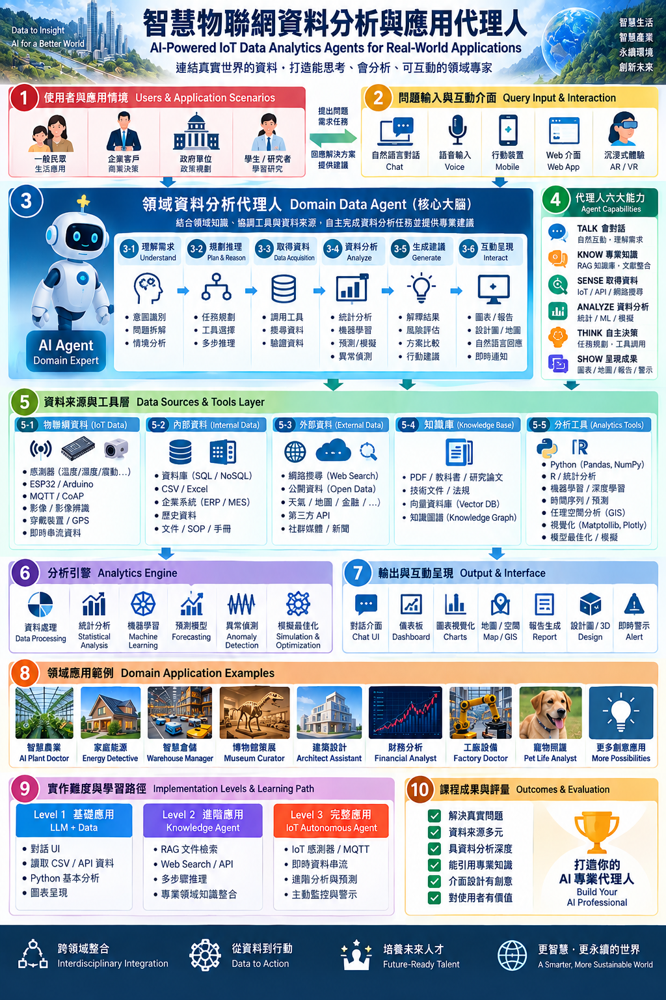

# Part 3. 課程專題說明

# **智慧物聯網資料分析與應用代理人：整體架構說明**

這張架構圖以 **「真實問題 → 人機互動 → AI Agent → 資料與工具 → 分析 → 呈現 → 領域應用」** 為主線，並依照圖中的 **①～⑩** 建立完整的課程與專題實作架構。核心精神不是讓學生只做一個聊天機器人，也不是只做傳統 IoT Dashboard，而是讓每位學生選擇一個自己感興趣的領域，打造一位真正能夠**理解問題、取得資料、分析資料、運用專業知識、提出建議並與使用者互動的「AI 專業代理人」**。

# **① 使用者與應用情境｜Users & Application Scenarios**

整個系統不是從「我要用哪一個 AI 模型」開始，而是從 **「我要替誰解決什麼問題？」** 開始。圖中的第一區將使用者分成一般民眾、企業客戶、政府單位、學生與研究者等不同角色，每一種角色面對的問題、擁有的資料以及期待得到的結果都不相同。

例如，一般家庭可能希望知道「為什麼這個月電費突然增加？」；企業可能想知道「倉庫如何重新配置才能提升 30% 出貨效率？」；農業使用者可能會問「為什麼最近番茄葉片開始變黃？」；研究人員則可能希望分析長期環境感測資料。

因此學生在專題開始時，首先必須定義三件事情：**我的 Agent 是誰？服務誰？解決什麼真實問題？** 這三個問題會成為後續資料、模型、工具與介面設計的起點。

# **② 問題輸入與互動介面｜Query Input & Interaction**

確定使用者之後，第二層是思考 **「人要如何與這位 AI 專家互動？」**。圖中設計了自然語言對話、語音、行動裝置、Web App，甚至 AR／VR 等不同形式，代表未來的資料分析系統不應只停留在傳統表單與 Dashboard。

例如使用者可以直接說：「幫我分析最近七天溫室的狀況。」系統必須理解「最近七天」、「溫室」、「狀況」背後真正需要的資料與分析任務，而不是要求使用者自己選擇資料表、欄位與演算法。

因此，**自然語言是人與複雜資料系統之間的新介面**。學生可以把創意放在不同互動方式上，有人做 Chat，有人做 Voice Agent，也有人可以設計行動式 Dashboard。

# **③ 領域資料分析代理人｜Domain Data Agent**

③ 是整張圖的**核心大腦**。

Domain Data Agent 並不是單純把問題送給 LLM，再把 LLM 的文字回答顯示出來。真正的 Agent 應該能夠將一個複雜問題拆解成多個步驟，知道應該取得哪些資料、呼叫哪些工具、進行哪些分析，再根據分析結果產生建議。

因此圖中又把 Agent 的工作流程拆成 **③-1～③-6 六個連續階段**：

**③-1 理解需求（Understand）**：辨識使用者的意圖、問題、限制條件與情境。例如「最近電費很高」背後可能真正要解決的是「找出異常耗電來源」。

**③-2 規劃推理（Plan & Reason）**：Agent 決定接下來應該做什麼。例如先取得智慧插座資料，再取得室外氣溫，接著比較本月與上月的冷氣使用情況。

**③-3 取得資料（Data Acquisition）**：真正呼叫工具，從 IoT、資料庫、API、文件或網路取得需要的資訊。

**③-4 資料分析（Analyze）**：將資料交給 Python、R、SQL、統計、Machine Learning 或其他分析工具，而不是讓 LLM 憑文字猜答案。

**③-5 生成建議（Generate）**：將分析結果轉化為人可以採取的行動，例如提出三個節能方案，並比較成本、效果與風險。

**③-6 互動呈現（Interact）**：最後透過自然語言、圖表、Dashboard、地圖、設計圖或警示呈現結果。

因此整個 Agent 可以理解成：

**Understand → Plan → Acquire → Analyze → Generate → Interact**

這也是所有學生作品可以共同遵循的標準 Agent Workflow。

# **④ 代理人六大能力｜Agent Capabilities**

③ 描述的是 Agent **「怎麼工作」**，④則定義一位合格的領域代理人應該 **「具備哪些能力」**。

第一項 **TALK** 是與人自然對話、理解需求；第二項 **KNOW** 是擁有專業知識，可以透過 RAG、文件、課本或知識庫補充 LLM 原本不知道的領域內容；第三項 **SENSE** 是能夠取得 IoT、API、Database 或 Web 的真實資料。

因此可以把一位完整 AI 專業代理人的能力濃縮為：

**TALK × KNOW × SENSE × ANALYZE × THINK × SHOW**

這六項也非常適合直接成為未來的**專題評分指標**。

# **⑤ 資料來源與工具層｜Data Sources & Tools Layer**

第四項 **ANALYZE** 是能真正進行統計、機器學習、預測或視覺化分析；第五項 **THINK** 是能根據目前結果決定下一個步驟與需要呼叫的工具；第六項 **SHOW** 則是把結果轉換成圖表、地圖、報告、警示或其他適合使用者的形式。

如果③是大腦，那麼⑤就是 Agent 的**眼睛、耳朵、記憶與工具箱**。Agent 自己不需要擁有所有資料，而是知道什麼時候應該使用哪一種資料來源。

**⑤-1 物聯網資料 IoT Data**

包括溫度、濕度、震動、光照、電流、GPS、影像以及其他感測器，可以透過 ESP32、Arduino、MQTT、CoAP 等技術取得。這一區保留了本課程最重要的 **IoT 核心特色：讓 AI 能感知真實世界。**

**⑤-2 內部資料 Internal Data**

包括 SQL／NoSQL、CSV、Excel、ERP、MES、歷史資料、SOP 與企業文件。很多實際的 AI 應用不需要感測器，而是從既有企業資料開始。

**⑤-3 外部資料 External Data**

包括 Web Search、Open Data、天氣、地圖、金融資料、第三方 API、新聞或其他公開網路資源。如此一來 Agent 的世界不再被限制在單一資料庫。

**⑤-4 知識庫 Knowledge Base**

這一區負責提供**領域專業知識**。可以放入課本、PDF、論文、技術文件、法規，再利用 RAG、Vector Database 或 Knowledge Graph 進行檢索。

**⑤-5 分析工具 Analytics Tools**

包括 Python、Pandas、NumPy、R、統計分析、Machine Learning、Deep Learning、Time Series、GIS、視覺化、模擬與最佳化。

這一層最重要的觀念是：

**LLM 不必自己做所有事情；真正好的 Agent，是知道什麼時候該使用什麼工具。**

# **⑥ 分析引擎｜Analytics Engine**

⑥ 是這門「資料分析」課程與普通生成式 AI 課程最重要的分界。

Agent 取得資料後，必須真正執行 **Data Processing、Statistical Analysis、Machine Learning、Forecasting、Anomaly Detection、Simulation、Optimization** 等工作。

例如工廠設備代理人不能只回答「馬達可能過熱」，而應該讀取溫度、電流與振動資料，與歷史正常區間比較，找出異常時間點；能源代理人則應分析各設備耗電比例與氣溫關係，再估算不同節能方案可能帶來的效果。

因此課程應建立一個重要原則：

**LLM 負責理解、推理與解釋；Analytics Engine 負責計算、驗證與提供證據。**

如此才能避免學生最後只是做出不同外觀的 ChatGPT。

# **⑦ 輸出與互動呈現｜Output & Interface**

分析的目的不是產生更多資料，而是讓人**看懂並採取行動**。

因此⑦不把輸出限制成文字，而是包含 Chat UI、Dashboard、Charts、Map／GIS、Report、Design／3D 以及 Alert 等形式。

例如財務 Agent 最重要的可能是風險圖表；智慧農業 Agent 可能需要田區地圖；智慧倉儲 Agent 可以呈現貨架與物流配置；建築 Agent 可以比較不同設計方案；工廠 Agent 則可以提供設備健康狀態與即時警示。

所以這一層可以讓學生發揮 UI／UX 創意。**不同專業的 Agent，應該擁有不同的專業工作介面，而不是全部長成同一個聊天視窗。**

# **⑧ 領域應用範例｜Domain Application Examples**

⑧ 告訴學生：**這套架構不是限制題目，而是讓題目可以無限延伸。**

例如 **AI Plant Doctor** 可以結合植物影像、土壤濕度、溫度與天氣資料診斷植物問題；**Energy Detective** 可以找出家庭異常耗電來源；**Warehouse Manager** 可以分析庫存、訂單與貨架配置；**Museum Curator** 可以根據館藏與觀眾特性協助策展。

同樣的架構也能形成 **Architect Assistant、Financial Analyst、Factory Doctor、Pet Life Analyst** 等完全不同的作品。

這裡最重要的是讓學生知道：

**不是大家做同一個 IoT 題目，而是大家使用同一套架構，創造完全不同的 AI 專業人員。**

因此學生可以從自己的科系、興趣、家庭、研究、工作甚至嗜好尋找題目。

# **⑨ 實作難度與學習路徑｜Implementation Levels & Learning Path**

為了讓不同程度的學生都能完成作品，圖中將實作分成三個 Level。

**Level 1：LLM + Data** 是基礎完成線。學生建立對話介面，讀取 CSV、Database 或 API，利用 Python 做資料分析，再用圖表呈現。重點是先建立完整的「問題 → 資料 → 分析 → 回答」流程。

**Level 2：Knowledge Agent** 進一步加入 RAG、文件檢索、Web Search、API 與多步推理，使 Agent 開始具有真正的領域專業能力。

**Level 3：IoT Autonomous Agent** 則加入 IoT Sensor、MQTT、即時資料流、進階分析與主動警示，使 Agent 不需要等人詢問，而能持續觀察環境，在發現異常時主動採取行動或提出建議。

因此學生可以依能力逐步成長：

**LLM + Data → Knowledge Agent → IoT Autonomous Agent**

而不是一開始就要求所有學生完成非常複雜的 Autonomous Agent。

# **⑩ 課程成果與評量｜Outcomes & Evaluation**

最後⑩回答一個最重要的問題：**什麼叫做一個成功的期末作品？**

評量不應該只看用了多少 AI 套件，也不應該只看畫面是否漂亮，而是看 Agent 是否真的具有價值。圖中可以歸納成六項核心成果：**能解決真實問題、資料來源多元、資料分析具有深度、能引用專業知識、介面設計具有創意，以及最重要的——對真正的使用者產生價值。**

所以學生期末展示時，不應該只是介紹：

「我們用了 Python、FastAPI、RAG 和 LLM。」

而應該能說：

**「我們打造了一位什麼樣的 AI 專業代理人，它服務誰、取得哪些資料、如何分析、根據什麼知識做判斷，以及最後替使用者解決了什麼問題。」**

# **從①到⑩：整門課其實就是一條完整故事線**

把整張圖由上往下看，可以得到非常清楚的課程主線：

**① 找到使用者與真實情境 → ② 設計人機互動 → ③ 建立 Domain Data Agent → ④ 賦予 Agent 六大能力 → ⑤ 連接 IoT、資料、網路與知識 → ⑥ 執行真正的資料分析 → ⑦ 將結果互動呈現 → ⑧ 發展成不同領域應用 → ⑨ 依能力逐級完成 → ⑩ 打造真正有價值的 AI Professional。**

因此，「智慧物聯網資料分析與應用代理人」真正要培養的，不只是 IoT、Python 或 LLM 的單一技術，而是學生**整合真實世界、資料分析、領域知識與人工智慧的能力**。

最終課程的核心精神可以濃縮成：

**From Data to Insight, From Insight to Action.**

**從資料到洞察，從洞察到行動。**

而期末專題真正的目標則是：

**Build Your AI Professional — 打造一位真正能替人解決問題的 AI 專業代理人。**