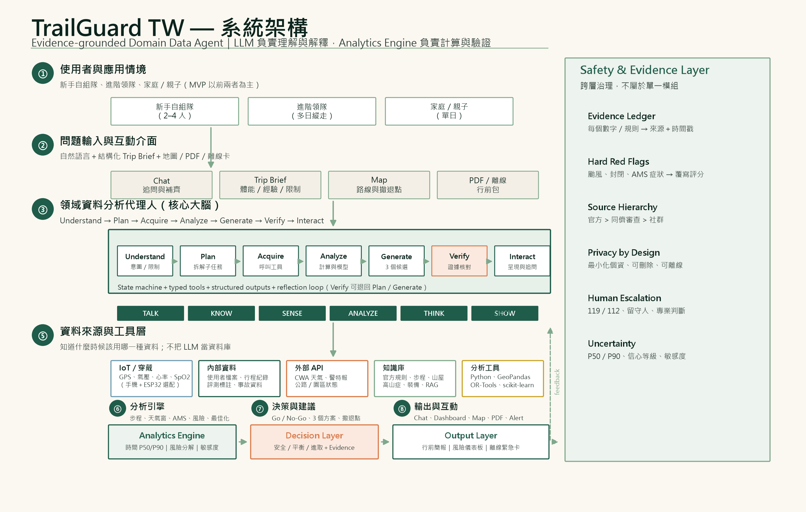
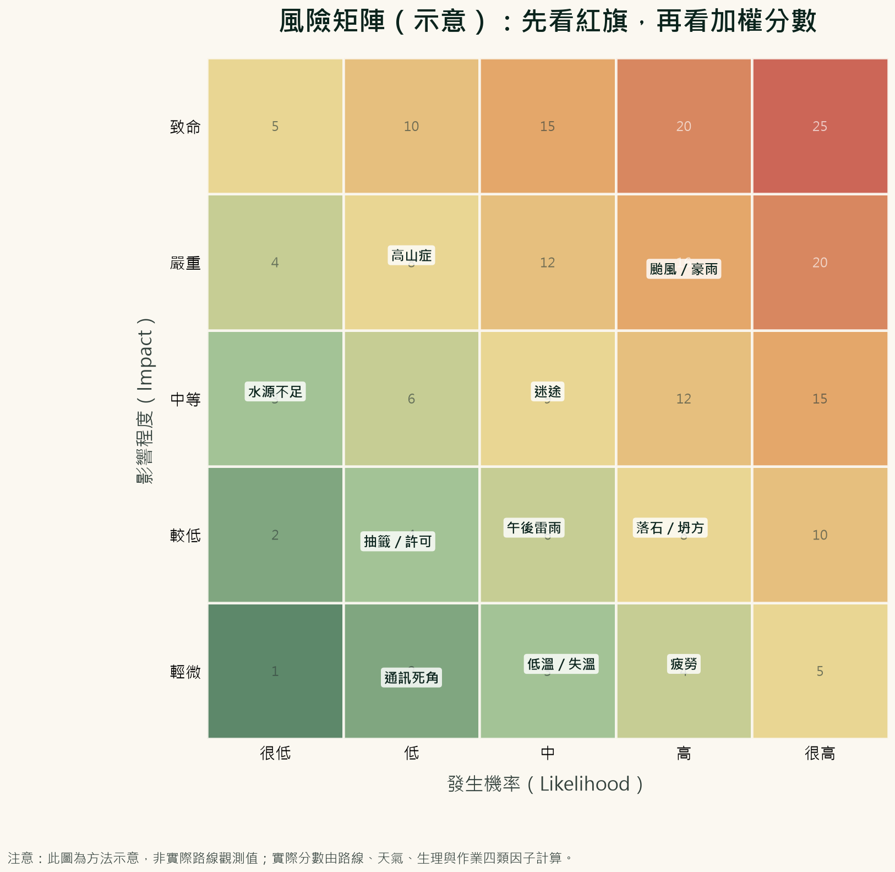
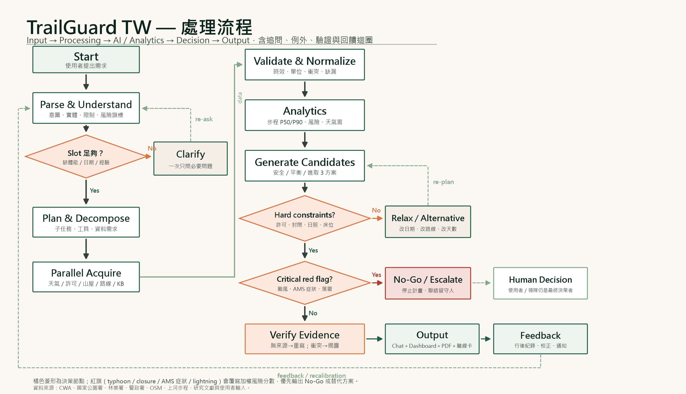
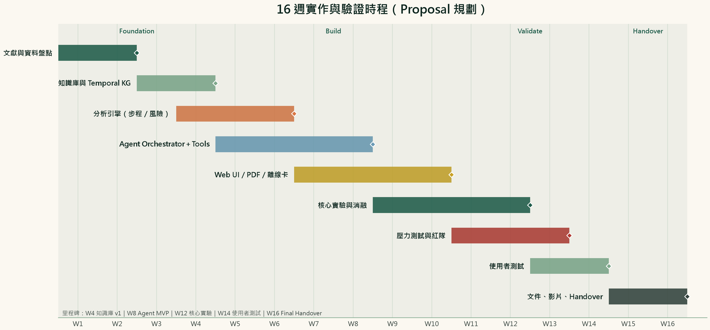

# 山徑守護者（TrailGuard TW）

## 以證據為基礎的臺灣高山行程規劃與風險決策支援代理人

**TrailGuard TW: An Evidence-Grounded Domain Data Agent for High-Mountain Trip Planning and Risk Decision Support in Taiwan**

---

**課程：** 物聯網應用與資料分析  
**授課教師：** 陳煥 教授  
**組員：** 陳俊安、廖家暉、温偉成、郭冠良  
**日期：** 2026-10-31  
**版本：** v0.1 Proposal

> 本文件為期末專題「提案」版本。文中所有系統成效數字均為**設計目標、驗收門檻或預期成果**，尚未進行正式實驗，不代表已觀察到的實驗結果。

---

<!-- TOC -->

# 摘要

## A. Attention Getter — Motivation

臺灣高山活動在 2019 年「開放山林」後快速成長，但風險並沒有隨之下降。內政部統計 2015 至 2024 年間共發生 3,450 件山域事故，其中「迷路」1,263 件、約占 37%，是最大宗；政府雖已建置 602 面可通話地點標示，仍難以消除高山通訊死角與資訊落差 [1]。國家公園署進一步指出，2025 年玉山、太魯閣、雪霸三座高山型國家公園約有 15.2 萬人次入園，平均每萬人發生 9 件事故；事故原因以創傷（31.2%）最高，其次為高山症與墜谷（各 15.6%）、迷路（12.8%）、疲勞（6.4%）與疾病（5.8%）。更值得警惕的是，山域事故發生率由 2016–2019 年的 0.04–0.05%，上升到 2023–2025 年的 0.08–0.09% [2]。這些數字說明：問題不只是「有沒有山難」，而是**行前決策與風險資訊沒有被有效整合**。

## B. But — Challenge

既有工具各自解決片段問題：一站式服務網提供入園申請與路線資訊，氣象署提供天氣預報，社群與 GPX 平台提供路況與軌跡，上河文化等地圖提供步程參考。然而，新手自組隊仍必須在多個網站、PDF、社群貼文與個人經驗之間自行拼湊，才能回答「這條路線適合我們嗎？」「午後雷雨會卡在哪一段？」「同行者高山症風險多高？」「幾點前沒到撤退點就該回頭？」。大型語言模型（LLM）雖然能生成看似完整的行程，卻可能忽略硬性限制、混淆資料時效，甚至給出「看起來安全」但沒有來源支撐的建議。TravelPlanner 的結果即顯示，即使是 GPT-4，在多重約束的真實行程規劃上成功率也只有 0.6% [10]。**因此，真正的缺口不是再做一個聊天機器人，而是建立一個能把領域知識、即時資料、數值分析與安全責任分開處理的決策支援系統。**

## C. Cure — Proposed Solution

為了解決上述問題，本專題提出 **TrailGuard TW（山徑守護者）**：一個以證據為基礎（evidence-grounded）的臺灣高山行程規劃與風險決策支援代理人。它服務新手與半經驗自組隊，主要輸出不是一段華麗文字，而是**可追溯、可驗證、可行動**的行前決策包：三個候選行程（安全／平衡／進取）、逐段風險儀表板、撤退點與回頭時間、裝備與水源檢查表、離線緊急卡，以及每一項數字的來源與時間戳。

## D. Development — Method

系統採「LLM 負責理解、規劃與解釋；Analytics Engine 負責計算、驗證與提供證據」的分工。LLM 透過狀態機與工具呼叫完成意圖解析、缺槽追問、任務拆解與說明生成；Python 分析引擎負責步程估計、天氣窗格、高山症風險篩檢、路線風險分解與行程最佳化；領域知識層則以**時序知識圖譜（Temporal Knowledge Graph）＋混合式檢索增強生成（Hybrid RAG）**整合官方規範、步道分級、山屋與水源、事故統計、醫學指引與社群回報。所有數值與規則都必須寫入 **Evidence Ledger**，沒有來源就沒有數字（No source, no number）。系統另設**硬性紅旗覆寫**（hard red-flag override）：颱風警報、步道封閉、嚴重高山症症狀等情況，直接輸出 NO-GO 或升級人工，不允許被平均分數抵銷。

## E. Experiments — Evaluation

本提案規劃 120 個評估案例：30 條臺灣高山路線 × 3 種人物誌（新手、半經驗、資深領隊）共 90 個核心情境，加上 30 個壓力與對抗案例（資料衝突、缺資料、幻覺誘導、錯誤體能自述、突發封閉）。對照組包含 GPT-4o zero-shot、GPT-4o＋網路搜尋、RAG-only、人工流程，以及移除知識圖譜、移除驗證層、移除紅旗層等消融版本。主要指標為限制滿足率（CSR）、證據覆蓋率（EGR）、**錯誤安全率（False-Safe Rate, FSR）**、步程誤差（MAE）、專家可接受度、系統使用性量表（SUS）、延遲與成本。目標值分別為 CSR ≥ 85%、EGR ≥ 95%、FSR ≤ 2%、步程 MAE ≤ 20%、SUS ≥ 75；所有數字均為驗收門檻，將以信賴區間與統計檢定報告。

## F. Findings — Expected Outcomes

預期完成一個可操作的 Web 原型、一套可重現的評估協定、一份 Evidence Ledger 與 Temporal KG 設計，以及一組能區分「真安全」與「假安全」的測試案例。若目標達成，本專題的貢獻不只是做出一個登山助手，而是示範一種可移植的領域代理人範式：**把不確定性、時效性與安全責任，設計進 AI Agent 的架構，而不是事後補救。**

**關鍵詞：** 高山症、風險決策、行程規劃、檢索增強生成、時序知識圖譜、可解釋人工智慧、領域資料代理人

---

# 壹、緒論

## A. Attention Getter：一座山，為什麼需要一位「會說不」的代理人？

臺灣的高山不是遙遠的異國場景，而是週末可及的日常。正因為可及，風險更容易被低估。2024 年 9 月，消防署統計顯示 2023 年山難獲報 513 件、48 人死亡，創下 22 年新高；2024 年 1 至 8 月已有 51 人死亡。事故族群以 50 至 59 歲的自組隊伍最多，原因包括隊員彼此不熟、不了解身體狀況、脫隊迷路，以及疾病與創傷 [3]。另一邊，國家公園署的資料則顯示，2023–2025 年高山型國家公園事故率升至 0.08–0.09%，是 2016–2019 年的近兩倍 [2]。

這些數字背後有一個共同的決策結構：**登山者必須在資訊不完整、天氣不確定、身體狀況會變化的情況下，做出「去／不去」「走到哪裡」「幾點回頭」的決定。** 目前的數位工具多半只提供資料，不提供決策；只提供答案，不提供證據；只提供樂觀行程，不提供撤退條件。這正是 TrailGuard TW 想補上的位置。

## B. Background：應用領域、使用者與技術背景

**應用領域。** 臺灣高山型國家公園與林業署管轄之百嶽、中級山路線，涉及入園許可、山屋抽籤、水源、通訊點、崩塌與封閉、雪季與颱風季等複雜限制。玉山國家公園將步道分為 0 至 6 級，並要求登山者依自身能力選擇路線 [5]；高山症衛教則明確指出，登玉山者超過 25% 符合急性高山病診斷，且嚴重高山症可能導致墜崖、失溫等二次事故 [4]。這些都是「一般旅遊規劃」不會出現的領域約束。

**主要使用者。** 本專題以**新手與半經驗的自組登山隊**為主要對象（2–6 人、1–4 天、需自行處理交通、抽籤、裝備與風險），次要使用者為**帶隊的資深領隊與登山社團幹部**。前者需要「幫我把資訊整合成可行動的計畫」，後者需要「幫我快速檢查盲點與留下決策紀錄」。

**技術背景。** LLM 已具備自然語言理解、工具呼叫與多步推理能力；RAG 能把外部知識帶入生成；Agentic RAG 進一步讓代理人在檢索過程中規劃、反思與呼叫工具 [11][14]。知識圖譜則適合表達「路線—段—山屋—水源—通訊點—風險事件」之間的關係。與此同時，行程規劃不是單純問答，而是**多重約束滿足與在不確定性下最佳化**的問題；TravelPlanner 已證明，單靠 LLM 的自由生成不足以穩定處理這類任務 [10]。

## C. Problem：真正需要解決的問題

本專題要解決的核心問題不是「如何生成一份登山計畫書」，而是：

> **如何在資料不完整、預報不確定、使用者能力差異大的情況下，產生一份「不會把不該上山的人送上山」的個人化高山行程，並讓每一個判斷都能被追溯、被質疑、被人類接手？**

這個問題可拆成四個子問題：

1. **語意問題：** 使用者說「我想爬玉山，兩天一夜，輕鬆一點」，系統能否辨識這其實包含「新手、週末、抽籤、山屋、午後雷雨、高山症」等多重隱含限制？
2. **資料問題：** 系統能否取得並對齊官方入園規則、即時天氣、步道封閉、山屋狀態、水源與通訊點，而不是依賴訓練資料中的舊資訊？
3. **分析問題：** 系統能否用可解釋的數值方法估計步程、風險與不確定性，而不是讓 LLM 憑感覺給出「應該可以」？
4. **責任問題：** 當系統發現紅旗時，能否拒絕給出樂觀建議、清楚說明原因、提供替代方案，並把最終決定交還給人？

## D. Existing Limitations：現有方法為什麼不夠

**第一，資訊碎片化。** 入園申請、天氣、步道封閉、山屋、水源、GPX、社群路況分散在不同網站與平台。使用者必須自己拼湊，且難以判斷哪一筆資料最新、哪一筆適用於自己的日期與路線。

**第二，LLM 的「流暢陷阱」。** LLM 擅長生成結構完整、語氣自信的行程，但缺乏可靠的數值計算、時效驗證與 constraint checking。TravelPlanner 的研究顯示，GPT-4 在 1,225 個多約束行程意圖上成功率僅 0.6%，常見失敗包括偏離任務、用錯工具、漏掉限制 [10]。在登山情境中，這種錯誤不是「行程不完美」，而可能是「把隊伍帶進午後雷雨或失溫風險」。

**第三，步程估算過度簡化。** 上河文化的步程圖明確提醒，步程是參考值，必須依天氣、路況、隊伍速度調整 [9]。2025 年的一項研究也發現，常見平台與標示的步程估算與實際行走時間存在顯著落差，個人化方法才能接近實際 [17]。若系統直接把「上河時間」當成保證，會系統性低估風險。

**第四，風險資訊缺乏個人化。** 同一條路線對資深領隊與第一次上高山的新手，風險完全不同。高山症風險與上升速度、睡眠海拔、過去病史、血氧與症狀有關 [4][20]；但現有行程工具多半只提供固定難度等級，沒有把隊伍組成、體能、裝備與醫療史納入。

**第五，沒有「錯誤安全」的評估。** 現有旅遊規劃 benchmark 多半評估「行程是否滿足偏好」，較少評估「系統是否在高風險情況下錯誤地說 GO」。對安全關鍵領域而言，後者才是致命錯誤。本專題因此把 **False-Safe Rate** 列為核心指標。

## E. Innovation：與既有系統有何不同

TrailGuard TW 的創新不在於「用了 LLM」，而在於把下列五件事放進同一個架構：

1. **Evidence Ledger（證據帳本）：** 每一個數字、規則與建議都綁定來源、擷取時間、有效期間與信心等級；沒有來源的數字不得輸出。
2. **Temporal Knowledge Graph（時序知識圖譜）：** 將路線、分段、山屋、水源、通訊點、封閉事件、天氣與規範以「有效時間」連結，解決「資料是舊的」這個常見問題。
3. **Hard Red-Flag Override（硬性紅旗覆寫）：** 颱風、封閉、嚴重高山症等紅旗直接覆寫加權分數，避免「其他項目很安全」抵銷致命風險。
4. **Risk-Constrained Itinerary Optimization（風險約束行程最佳化）：** 不只排景點，而是在日照、山屋、撤退點、體能與天氣窗格下，產生安全／平衡／進取三個候選，並計算 P50／P90 不確定性。
5. **False-Safe Evaluation（錯誤安全評估）：** 以「不該 GO 卻說 GO」為一級錯誤，建立對抗案例與專家標註，讓安全成為可測量的指標。

## F. Contributions：預期貢獻

**技術貢獻。**

- 提出一個可重複使用的「LLM＋Analytics＋Temporal KG＋Evidence Ledger」領域代理架構，並以登山安全作為驗證場域。
- 設計一個能處理時效衝突、資料缺漏與來源可信度的混合式檢索與證據驗證流程。
- 提出風險約束下的行程最佳化與紅旗覆寫機制，將安全規則與最佳化分層。
- 建立以 False-Safe Rate 為核心的安全關鍵代理評估協定。

**應用貢獻。**

- 為臺灣新手自組隊提供一份看得懂、帶得走、能離線使用的行前決策包。
- 降低「資訊落差」造成的可預防風險，特別是午後雷雨、高山症、迷途與撤退判斷。
- 為領隊與登山教育提供可追溯的決策紀錄，方便行後檢討與經驗累積。

**文件與社群貢獻。**

- 公開資料來源清單、評估案例設計、DESIGN.md 與可重現的實驗腳本（Final Handover 階段）。
- 以繁體中文與臺灣在地路線為核心，補足現有英文為主的 AI 規劃研究缺口。

---

# 貳、相關研究

本章依「約一半 AI 技術、一半領域知識」配置。AI 部分聚焦 LLM 代理、檢索增強生成、知識圖譜與規劃驗證；領域部分聚焦臺灣山域事故、步程估算、高山症與路線風險。最後以 Article Summary Table 收斂研究缺口。

## A. AI 技術：從生成式模型到可驗證的領域代理人

### A-1. LLM 代理與工具呼叫

ReAct 將「推理」與「行動」交錯，讓模型在每一步決定要檢索什麼、呼叫哪個工具、觀察到什麼，再更新下一步 [13]。這個範式適合登山規劃，因為使用者需求往往需要多輪補齊（日期、人數、經驗、交通、山屋），且資料來源會隨時間變動。然而，ReAct 本身不保證事實正確，也不保證工具輸出被正確解讀；因此本專題在其上加入型別化工具（typed tools）、結構化輸出與驗證層。

### A-2. RAG、Agentic RAG 與 GraphRAG

RAG 將外部文件檢索後再生成，可降低幻覺並引入最新知識 [12]。Gao 等人的綜述指出，RAG 的關鍵不只在大模型，而在檢索品質、文件切分、重排與評估 [14]。Agentic RAG 進一步把檢索變成主動流程：代理人會改寫查詢、選擇來源、反思檢索結果是否足夠 [11]。GraphRAG 則透過實體與社群摘要，改善「全局性問題」與跨文件關聯 [15]。Self-RAG 讓模型自我判斷是否需要檢索、檢索結果是否支持生成 [16]。

對本專題而言，這些方法解決了「知識從哪來」，但沒有完全解決「知識是否適用於此時此刻」與「多個來源衝突時誰優先」。因此，我們需要時序知識圖譜與來源階層，而不只是向量檢索。

### A-3. 行程規劃與多約束最佳化

TravelPlanner 提供 1,225 個人工策劃的行程意圖與近 400 萬筆資料記錄，發現 GPT-4 的成功率僅 0.6%，主要失敗在於無法保持任務、選錯工具、漏掉多重限制 [10]。TP-RAG 進一步針對時空感知的旅遊規劃，顯示檢索能改善規劃，但複雜約束仍是挑戰 [22]。這些研究告訴我們：**行程規劃不能只靠 prompt，必須有外部求解器與驗證器。**

本專題採用 LLM 負責「把問題說清楚」與「把結果說明白」，並以 OR-Tools CP-SAT 或啟發式搜尋處理硬約束與最佳化；LLM 不直接計算步程或風險分數。

### A-4. 可解釋性與不確定性

安全關鍵系統不能只給答案，還要給「為什麼」與「有多確定」。本專題以 Evidence Ledger 記錄每個數字的來源與時間，以 P50／P90 與敏感度分析呈現不確定性，並在輸出中區分「事實」「推論」「建議」三種語句。這比單純要求 LLM「請附上來源」更可靠，因為驗證是在生成之後由程式執行，而不是依賴模型自我宣稱。

## B. 領域知識：臺灣高山風險的五個關鍵結構

### B-1. 事故結構：迷途、創傷、高山症

內政部 2015–2024 年統計顯示，迷途佔山域事故 37%，其次是創傷與高山症 [1]。國家公園署 2025 年資料則顯示，高山型國家公園事故以創傷 31.2% 最高，高山症與墜谷各 15.6%，迷路 12.8% [2]。這意味著系統不能只做「路線難度」，還要處理**導航、通訊、醫療與撤退**四個面向。

### B-2. 高山症：不是罕見事件，而是可預防的劑量—反應問題

玉山國家公園衛教指出，登玉山山友超過 25% 符合急性高山病診斷；高山症與上升速度、睡眠海拔、個人易感性有關，嚴重時可能導致步態不穩、墜崖、肺水腫與腦水腫 [4]。Wilderness Medical Society 2019 指引建議緩慢上升、出現症狀時不再上升、嚴重症狀應下降並尋求醫療 [20]。2023 年一項研究以 SVM-RFE 建立重症高山症預測模型，顯示機器學習可輔助篩選，但仍需外部驗證 [19]。

**設計意涵：** 系統應把高山症風險做成「行前篩檢＋行程中監測＋紅旗升級」三段式，而不是一個靜態分數。MVP 以透明規則與風險因子計分為主，待累積足夠資料後再校準統計模型；且**不提供診斷、處方或藥物劑量**。

### B-3. 步程：參考值不是保證

上河文化的百嶽步程圖是臺灣登山者常用的參考，但其網站明確說明步程會受天氣、路況與隊伍速度影響 [9]。Vecchiato 等人比較義大利步道上的實際 GPS 軌跡與 Komoot、Outdooractive、標示與 MOVE 演算法，發現前三者與實際時間有顯著偏差，MOVE 的誤差則不顯著 [17]。Pitman 等人則以個人化成本函數改善 Naismith 規則，最多改善 23% [18]。

**設計意涵：** 系統應以 Tobler／Naismith 為基準，加入個人化校正、休息、揹負、天候與海拔修正，並輸出 P50／P90，而不是單一時間。

### B-4. 路線分級與許可：制度也是風險因子

玉山國家公園以 0–6 級步道分級協助民眾選擇路線 [5]；入園許可、山屋抽籤、封閉與雪季規範會直接改變可行行程 [6]。這些制度資訊具有強時效性，不能依賴 LLM 的記憶。系統必須把「許可狀態」「封閉狀態」「山屋床位」視為硬約束，並在天氣或封閉變更時觸發重規劃。

### B-5. 社群資訊：有用，但必須降權與標記時間

GPX 平台、登山社群與路況回報能補足官方資料的空白（例如水源、崩塌、通訊點），但品質不一、可能過時或有主觀偏差。本專題採來源階層：官方公告＞同儕審查文獻＞官方統計＞具名社群回報＞匿名社群貼文。社群資料只能用於「提示」與「待查證」，不能單獨成為 NO-GO 或 GO 的唯一依據。

<!-- LANDSCAPE -->

## C. Article Summary Table

> 下表以「問題—AI 方法—領域知識—資料—發現—限制」整理 12 篇代表性文獻與官方資料。此表同時用於說明：現有研究在 AI 或領域各自有進展，但較少將「時效、個人化、硬性安全規則、證據追溯」整合為一個可運作的代理人。

<!-- TABLE 表 1　文獻摘要表：12 篇代表性研究（AI 技術 × 登山領域） -->

| Ref. | Year | Problem | AI Method | Domain Knowledge | Dataset | Findings | Limitation |
|---|---|---|---|---|---|---|---|
| [10] | 2024 | 多重約束的真實行程規劃 | LLM agent、tool use、benchmark | 旅遊行程、預算、限制 | 1,225 個意圖、近 400 萬筆記錄 | GPT-4 成功率僅 0.6%，常見偏離任務與漏限制 | 靜態沙盒、觀光情境、非安全關鍵、無證據帳本 |
| [22] | 2025 | 時空感知的旅遊規劃 | RAG agent、時空檢索 | POI、時間、地理限制 | 旅遊規劃 benchmark | 檢索可改善規劃，但複雜約束仍難 | 觀光情境、未處理山域風險與封閉 |
| [11] | 2025 | 靜態 RAG 不足以處理複雜查詢 | Agentic RAG、規劃、反思、工具 | 多步檢索與知識整合 | 綜述 | 代理人化檢索可提升複雜問答與適應性 | 缺乏領域安全驗證與成本評估 |
| [16] | 2024 | 幻覺與過度檢索 | Self-RAG、自我批判 | 檢索必要性與支持度 | QA 資料集 | 自我反思可改善事實性與引用 | 需標註、延遲較高、可能自我誤判 |
| [15] | 2024 | 全局問答與碎片化知識 | GraphRAG、社群摘要 | 實體關係與主題結構 | 文本語料 | 改善跨文件全局理解 | 建圖成本高、時效維護困難 |
| [17] | 2025 | 步程估算與實際落差 | GPS 軌跡比較、MOVE 演算法 | 登山步程、地形、個人化 | 義大利步道、Wikiloc GPS | 平台估算有顯著偏差；個人化方法較接近實際 | 單一地區、樣本有限、未含高山症 |
| [18] | 2012 | Naismith 規則未個人化 | 個人化成本函數 | 健行速度、體能、地形 | GPS 軌跡 | 相較 Naismith 最多改善 23% | 舊資料、未含天氣與海拔適應 |
| [19] | 2023 | 重症高山症預測 | SVM-RFE 特徵選取與分類 | 生理、海拔、臨床因子 | 臨床資料 | 機器學習可輔助重症高山症篩選 | 臨床場域、外部驗證不足、非即時 |
| [20] | 2019 | 高山症預防與治療 | 專家共識指引 | 上升速率、症狀、下降 | 臨床與野外證據 | 緩升、有症狀勿再上升、重症下降 | 非個人化、非即時、需臨床判斷 |
| [21] | 2023 | 戶外冒險推薦 | 推薦系統綜述 | 路線、偏好、情境 | 文獻回顧 | 個人化與情境感知是關鍵 | 較少討論安全、即時風險與責任 |
| [1] | 2025 | 臺灣山域事故特徵 | 官方統計分析 | 迷途、創傷、高山症、通訊 | 2015–2024 年 3,450 件 | 迷途 37%、602 面通訊標示 | 事後統計、無法即時預測 |
| [2] | 2026 | 高山型國家公園事故率上升 | 官方統計分析 | 入園量、事故原因、發生率 | 2025 年 15.2 萬人次 | 每萬人 9 件；創傷 31.2%、AMS 15.6%；事故率 0.08–0.09% | 描述性統計、未控制暴露與隊伍組成 |

<!-- PORTRAIT -->

## D. 研究缺口：Existing Research → Limitations → Research Gap → Our Project

**Existing Research。** AI 社群已發展出 LLM 代理、RAG、Agentic RAG、GraphRAG 與行程 benchmark；登山領域則有事故統計、步程研究、高山症指引與路線分級。兩邊都有扎實基礎。

**Limitations。** 第一，AI 規劃研究多以觀光為場域，較少處理「錯誤安全」的代價。第二，RAG 研究重視檢索與生成，但較少處理「來源衝突、資料過時、有效期間」的問題。第三，步程與高山症研究提供模型，但沒有被整合進可互動的行程決策流程。第四，現有登山工具提供資訊，但不提供可追溯的個人化決策與撤退建議。

**Research Gap。** 缺乏一個能把**時序知識、個人化分析、硬性安全規則、證據追溯與人類問責**整合在一起的臺灣高山行程代理人。

**Our Project。** TrailGuard TW 以此缺口為核心：以 Temporal KG 解決時效，以 Hybrid RAG 解決知識取得，以 Analytics Engine 解決計算，以 Evidence Ledger 解決追溯，以紅旗覆寫解決責任邊界，並以 False-Safe Rate 驗證安全性。

---

# 參、深度研究

本章回答三個問題：這個領域的專家如何思考？最重要的爭論是什麼？如何分辨一個人是否真正理解這個領域？

## A. 五個核心思維模式

### 思維一：安全餘裕優先於行程效率（Margin of Safety）

**意義。** 登山決策的目標不是「最大化山頂成功率」，而是在可接受的風險下完成行程。專家會保留時間、體力、飲水、保暖與撤退餘裕，並預設「會出事」而不是「應該沒事」。

**證據。** 高山症指引建議緩慢上升、有症狀不再上升、重症下降 [20]；臺灣山域事故中，迷途、創傷與高山症合計佔大多數 [1][2]。這些事故多半不是單一罕見事件，而是多個小失誤疊加。

**系統設計意涵。** 系統以 P90 而非平均值規劃行程；設定「回頭時間」（turnaround time）與最晚抵達撤退點時間；在行程中保留至少 20% 的時間緩衝；當緩衝不足時，即使總風險分數不高，也降級為 CONDITIONAL。

### 思維二：證據有階層，時間會改變答案（Evidence Hierarchy & Temporal Validity）

**意義。** 專家不會把「網友說有水」與「國家公園公告封閉」視為同等證據；也不會把去年的路況當成今年的路況。證據的價值取決於來源、時間、空間精度與可驗證性。

**證據。** 官方資料與社群資料在更新頻率、責任與格式上差異很大；山屋、水源、崩塌與通訊點都可能隨季節改變 [6][9]。RAG 研究也指出，檢索品質與文件時效會直接影響生成正確性 [14]。

**系統設計意涵。** 建立來源階層（官方＞同儕審查＞官方統計＞具名社群＞匿名社群）；所有證據都有 `observed_at`、`retrieved_at`、`valid_from`、`valid_to`；衝突時顯示雙方說法，不強行合併；過期資料自動降權或標記「待查證」。

### 思維三：風險是情境的函數，不是路線的標籤（Context over Label）

**意義。** 同一條玉山主峰，對單攻老手、親子團、雪季隊伍、午後雷雨中的隊伍，風險完全不同。專家會同時考慮路線、天氣、隊伍、裝備、時間與個人狀況。

**證據。** 玉山國家公園以 0–6 級步道分級，但仍要求民眾依自身能力與環境選擇 [5]；高山症風險與上升速率、睡眠海拔、個人易感性有關 [4][20]；步程會受天氣、路況與隊伍速度影響 [9][17]。

**系統設計意涵。** 不以「路線難度」單一分數決定一切；建立 `Route × Segment × WeatherWindow × TeamProfile × Time` 的風險向量；個人化只調整「可調整項」，不覆寫硬性紅旗。

### 思維四：計畫是假設，不是承諾（Plan as a Hypothesis）

**意義。** 行前計畫一定會被現場狀況修正。專家會設定檢查點、替代路線與撤退條件，並在天氣或身體狀況變化時重新評估。

**證據。** 高山天氣變化快速，午後雷雨、強風、降雪與地震後崩塌都可能使原計畫失效；國家公園與林業署會因災害公告封閉 [6]。TravelPlanner 也顯示，靜態規劃器容易漏掉變動中的限制 [10]。

**系統設計意涵。** 系統輸出的不是一份固定 PDF，而是一個「可重算的計畫物件」；每個檢查點都有 IF-THEN 規則（例如「12:00 未到排雲山莊→啟動 B 計畫」）；使用者回報後可重新計算，並保留版本差異。

### 思維五：撤退與問責是人類的責任（Retreat & Accountability）

**意義。** 專家知道何時放棄，也知道 AI 不能代替領隊承擔責任。系統可以提供建議、整理證據、提示紅旗，但最終決定必須由人做出，且要留下理由。

**證據。** 山域事故中，許多傷亡與「已經投入太多、不願撤退」有關；消防署與國家公園署持續倡導留守人制度與負責任登山 [1]。醫療指引也強調，嚴重症狀的處置是下降與就醫，而非繼續行程 [20]。

**系統設計意涵。** 設計 NO-GO／HOLD／GO 狀態；紅旗時輸出不對稱（寧可保守）；提供「人類決策」按鈕與理由欄；輸出緊急聯絡與留守人腳本；不提供醫療診斷或藥物劑量；在 UI 中明確標示「本系統不取代領隊與醫師」。

## B. 三個最重要的專業爭論

### 爭論一：面對不確定預報，應該「保守否決」還是「保留彈性」？

**觀點 A：保守否決。** 高山環境的錯誤代價極高，只要預報出現颱風、豪雨、強風或雷暴，就應直接 NO-GO，避免「僥倖心態」。證據是山域事故的嚴重後果與救援困難 [1][2]。

**觀點 B：保留彈性。** 過度保守會造成「狼來了」效應，使用者可能改去更危險的地方、或忽略系統提示；預報本身有不確定性，40% 降雨不等於一定下雨。證據是氣象預報的概率性與決策心理學中的 alarm fatigue。

**證據。** 支持「保守否決」的證據來自後果的不可逆性：2015–2024 年臺灣山域事故共 3,450 件、迷途占 37%，且高山型國家公園事故率由 2016–2019 年的 0.04–0.05% 升至 2023–2025 年的 0.08–0.09%，顯示錯誤一旦發生，救援與通訊條件都不站在當事人這邊 [1][2]。支持「保留彈性」的證據則來自預報的機率本質：中央氣象署鄉鎮市區預報以機率與時間區間呈現，40% 降雨機率同時意味 60% 不下雨 [7]；行為決策研究亦指出，過高的警報頻率會造成 alarm fatigue，使人對後續警報鈍化。兩邊證據都成立，但作用在不同層級——一邊談「不可逆後果」，一邊談「誤報成本」。

**共識。** 對「立即致命」的紅旗（颱風警報、步道封閉、雷暴、嚴重高山症）採硬性否決；對「概率性風險」（降雨、低溫、能見度）採分級與條件式建議，並揭露不確定性。

**未解問題。** 閾值怎麼訂？不同路線、不同隊伍的容忍度不同；如何避免系統過度保守而失去信任？本專題將以專家標註與使用性測試校準，並把「過度保守率」列為次要指標。

### 爭論二：應該「標準化步程與風險規則」還是「高度個人化」？

**觀點 A：標準化。** 上河步程、Naismith、國家公園分級是公共可理解的基準，容易溝通、可比較、資料需求低 [5][9]。

**觀點 B：個人化。** 每個人的體能、揹負、經驗、高山症易感性不同；標準化會系統性低估新手風險。研究顯示個人化步程模型可改善誤差 [17][18]。

**證據。** 支持「標準化」的證據是公共可驗證性：上河步程與國家公園步道分級公開、可溝通、可比較，資料需求低且不需個資 [5][9]。支持「個人化」的證據來自實測落差：以 GPS 軌跡比較，平台估算與實際步程存在顯著偏差，個人化成本函數相較 Naismith 規則最多可改善 23% 的誤差 [17][18]。但兩份研究的樣本分別來自單一地區與較舊資料，外部效度有限，「個人化一定更好」仍未成為共識。

**共識。** 以標準化為 baseline，加上個人化校正與不確定性；個人化不能覆寫硬性安全規則，且必須揭露「這是依你的自述調整，仍有誤差」。

**未解問題。** 個人資料稀疏時如何避免過度自信？如何處理使用者低報或高報體能？如何確保不同族群（年齡、性別、健康狀況）不被模型歧視？本專題採「保守先驗＋持續更新」與「最小資料收集」。

### 爭論三：AI 應該給「明確建議」還是「輔助人類判斷」？

**觀點 A：明確建議。** 使用者要的是答案，不是更多資訊；模糊的「僅供參考」會讓系統失去價值。尤其在時間壓力下，明確的 GO／NO-GO 更有用。

**觀點 B：輔助判斷。** 登山決策涉及價值、風險偏好與現場狀況，AI 不應承擔責任；過度明確的建議會造成 automation bias，讓使用者忽略矛盾證據。

**證據。** 支持「明確建議」的證據是任務失敗率：TravelPlanner 顯示 GPT-4 在多重約束的真實行程規劃上成功率僅 0.6%，說明缺少明確規則與驗證時，模型輸出的「建議」並不可靠 [10]。支持「輔助判斷」的證據來自自動化偏誤：當系統給出高信心結論時，使用者傾向減少自身查證，在安全關鍵場域這種鈍化比「沒有答案」更危險。目前尚無直接針對登山決策的對照實驗，這正是本專題要補的缺口之一。

**共識。** AI 提供「分級建議＋證據＋不確定性＋替代方案」，但最終決定與責任由人類承擔；紅旗時可以明確說「不建議前往」，但不代替領隊做現場判斷。

**未解問題。** 若系統說 GO 但發生事故，責任誰負？若系統說 NO-GO 但實際上安全，是否侵害使用者自由？這些問題需要法律、倫理與社群共同討論。本專題採「決策支援」定位，並在 UI 與文件中明確揭露限制。

## C. 十個深度理解問題

以下問題不是考名詞，而是考「能否在不確定性下做出合理判斷」。每個問題都附上「好的回答應該展現什麼」。

**Q1（Why）：臺灣高山事故率只有 0.08–0.09%，為什麼還值得做風險系統？**  
好的回答會指出：這是「每次入園人次」的比率，不是「每人一生」的風險；高山事故的後果嚴重、救援成本高、且多數可預防。更重要的是，比率上升代表風險並未隨裝備與資訊普及而下降 [2]。

**Q2（What-if）：預報顯示午後降雨機率 40%，你會取消行程嗎？**  
好的回答不會二分法，而會問：降雨集中在哪個時段？路線是否暴露於溪谷、稜線或崩塌地？隊伍是否有雨具與備用行程？40% 是概率，不是保證；決策應結合暴露時間與撤退點。

**Q3（Trade-off）：安全與登頂成功率之間，應該怎麼取捨？**  
好的回答會區分「可接受的風險」與「不可接受的風險」，並指出安全不是無限上綱；系統應提供安全／平衡／進取三個候選，讓使用者看見代價，而不是替使用者決定價值。

**Q4（Failure Case）：如果使用者謊報體能或隱瞞高山症病史，系統怎麼辦？**  
好的回答會說：系統不能完全驗證自述，因此要用保守先驗、行為問題（最近一次長程健行、負重、睡眠海拔）、以及行程中的檢查點來動態校正；對於關鍵自述，要求使用者確認，並在 UI 標示「未驗證」。

**Q5（Evidence）：官方公告說步道開放，但社群回報有崩塌，該信誰？**  
好的回答會說：官方公告是行政與責任基準，社群回報是即時風險提示；兩者衝突時應顯示雙方、標記時間與位置，並採保守處置（避開或延後），而不是自動合併成一個確定的答案。

**Q6（Comparison）：Naismith、Tobler 與個人化 ML，哪個比較好？**  
好的回答會比較資料需求、偏差、可解釋性與適用範圍：Naismith 簡單但忽略坡度與個人差異；Tobler 考慮坡度但仍是群體模型；個人化 ML 誤差較低但需要資料、可能過擬合。實務上應以 Tobler 為 baseline，加上個人化校正與不確定性 [17][18]。

**Q7（Design Decision）：系統應該有權限直接說「不可以去」嗎？**  
好的回答會區分「硬性紅旗」與「軟性風險」：颱風、封閉、嚴重症狀等應直接 NO-GO；其他情況應給條件式建議與替代方案。系統可以拒絕給出樂觀保證，但不能代替人類做所有價值判斷。

**Q8（Real-world Scenario）：隊友在 3,500 公尺出現頭痛、嘔吐、步態不穩，系統應該做什麼？**  
好的回答會優先辨識高山腦水腫紅旗，建議立即下降、尋求醫療與救援，不提供藥物劑量或「再觀察看看」的樂觀建議；同時通知留守人並提供位置與聯絡腳本 [4][20]。

**Q9（What-if）：入園許可已核准，但出發前步道因地震封閉，系統怎麼辦？**  
好的回答會說：許可不是安全保證；系統應以最新封閉公告為硬約束，自動重算替代路線或延期，並保留原許可與新狀態的證據紀錄。

**Q10（Evidence / Evaluation）：怎麼證明系統的建議是「安全」的？**  
好的回答會說：不能只用「使用者滿意」；需要專家標註、對抗案例、False-Safe Rate、限制滿足率、證據覆蓋率與前瞻性測試。安全是反事實的：我們要問「如果系統說 GO，實際上是否不該 GO」。

---

# 肆、提出方案

## A. 設計原則

1. **Evidence before fluency：** 先有證據，再有文字。任何數字都必須有來源、時間與適用範圍。
2. **Safety before optimization：** 先檢查硬性紅旗與法規，再做行程最佳化；安全不是加權分數的一部分，而是否決權。
3. **Uncertainty is a feature：** 輸出 P50／P90、信心等級與敏感度，而不是假裝確定。
4. **Personalization with humility：** 個人化只調整可調整項，不覆寫紅旗；自述資料標記為未驗證。
5. **Human in the loop：** 最終決定由使用者／領隊做出；系統提供證據、替代方案與升級路徑。
6. **Offline-first output：** 高山常無訊號，重要資訊必須可離線閱讀與列印。

## B. 使用情境與輸入

### B-1. 主要人物誌

<!-- TABLE 表 2　三種人物誌與對應系統策略 -->

| 人物誌 | 特徵 | 主要需求 | 系統策略 |
|---|---|---|---|
| 新手自組隊 | 1–2 次百嶽、2–4 人、依賴網路資訊 | 不知道怎麼選路線、看不懂步程與風險 | 主動追問、保守預設、白話解釋、行前檢查表 |
| 半經驗隊伍 | 3–10 次百嶽、有基本裝備、想挑戰縱走 | 需要個人化步程、山屋與撤退規劃 | 三個候選、P90 規劃、天氣窗格、B 計畫 |
| 資深領隊 | 帶隊經驗、熟悉路線 | 快速檢查盲點、留下決策紀錄 | 風險分解、證據帳本、匯出簡報、版本比較 |

### B-2. 範例情境（虛構，用於說明）

四人自組隊，預計 2027 年 4 月 10–12 日走玉山主峰三天兩夜。成員包含兩位第一次上高山的新手、一位曾有輕度高山的隊員、一位資深領隊。隊伍希望「不要太累、想看日出、但不想抽不到排雲」。系統接收：

- 日期、天數、路線偏好、可接受交通方式。
- 隊員年齡區間、最近三個月運動習慣、過去百嶽經驗、高山症病史（自述）。
- 可請假時間、預算、是否接受備案路線。
- 必要條件：不住山屋也可以、但不能單攻、不可走雪季路線。

系統輸出：

- 方案 A（安全）：三天兩夜、排雲山莊、第二天輕裝登主峰、第三天早退。
- 方案 B（平衡）：三天兩夜、若排雲未抽中則改住東埔山莊並調整為兩天一夜的替代路線。
- 方案 C（進取）：三天兩夜、加走西峰（僅在天氣與體能允許時）。
- 每個方案的逐段時間、天氣窗格、風險分解、撤退點、裝備清單、離線緊急卡。
- 若 4 月 10 日發布颱風警報或步道封閉，系統直接標記 NO-GO，並提供延期與替代路線。

### B-3. 輸入與輸出

<!-- TABLE 表 3　七類輸入與對應輸出 -->

| 類別 | 輸入 | 輸出 |
|---|---|---|
| 使用者 | 自然語言需求、Trip Brief、隊員資料 | 追問、個人化說明 |
| 路線 | 路線名稱、GPX、日期、天數 | 分段行程、海拔剖面、撤退點 |
| 環境 | 天氣、封閉、地震、雪季 | 天氣窗格、風險提示、替代方案 |
| 制度 | 入園許可、山屋抽籤、入山證 | 申請時程、備案、文件 checklist |
| 分析 | 步程、AMS、風險、最佳化 | P50／P90、風險分解、敏感度 |
| 證據 | 來源、時間、版本 | Evidence Ledger、引用、衝突提示 |
| 行動 | 裝備、水源、通訊、緊急聯絡 | 行前包、離線卡、留守人腳本 |

## C. 系統架構



架構採「核心代理人＋分析引擎＋知識層＋安全治理層」四層設計。LLM 不是資料庫，也不是計算器；它是協調者與解釋者。每一個工具都有明確的輸入／輸出 schema，回傳值必須附帶 provenance。Safety & Evidence Layer 橫跨所有模組，負責來源階層、證據帳本、紅旗規則、隱私與不確定性。

## D. 八個模組

### ① 使用者與應用情境（User & Scenario）

系統以人物誌與情境實例（trip brief）為起點，而不是從模型或資料表開始。模組①負責定義「誰、何時、去哪裡、為什麼、有什麼限制」，並決定預設的保守程度。新手預設較高的安全餘裕；資深領隊可調整顯示密度，但不能關閉紅旗。

### ② 問題輸入與互動介面（Query & Interaction）

支援自然語言、結構化 Trip Brief、地圖選點與 GPX 上傳。介面採「先問關鍵、再問細節」：一次只問一個會改變決策的問題（日期、人數、經驗、是否住山屋、是否有高山症病史），避免十題式表單。所有輸入都可修改，且系統會顯示「哪些假設是預設值」。

### ③ 領域資料分析代理人（Domain Data Agent）

核心大腦採狀態機（state machine）＋工具呼叫，流程為 `Understand → Plan → Acquire → Analyze → Generate → Verify → Interact`。狀態機負責控制流程與失敗重試；LLM 負責語意理解、任務拆解與說明生成；Python 工具負責計算與驗證。若工具回傳缺資料或衝突，代理人會進入 Clarify 或 Alternative 分支，而不是硬生成。

### ④ 資料取得與檢索（Data Acquisition & Retrieval）

包含 API connector、網頁抓取、開放資料、GPX 解析、PDF  ingestion 與社群回報。每個 connector 都有：
- schema 與單位轉換；
- timeout、retry、rate limit；
- 快取與 TTL；
- provenance（URL、擷取時間、版本）；
- 失敗時的 fallback（使用快取並標記過期）。

### ⑤ 分析引擎（Analytics Engine）

以 Python 實作，負責步程、天氣窗格、高山症風險、路線風險、行程最佳化與蒙地卡羅模擬。分析引擎回傳結構化 JSON，包含數值、單位、信心區間、方法版本與證據 ID。LLM 只能引用這些結果，不能自行改寫數字。

### ⑥ 領域知識整合（Domain Knowledge Integration）

以 Temporal KG＋Hybrid RAG 為核心。KG 負責關係與時效，RAG 負責文件語意與問答。兩者透過 entity linking 與 metadata filter 結合：先以 KG 找到相關路線與事件，再以 RAG 檢索官方規範與醫學指引，最後由 reranker 排序。

### ⑦ 決策與建議（Decision & Recommendation）

產生三個候選（安全／平衡／進取），對每個候選執行硬性限制檢查、紅旗檢查、證據驗證與風險評分。決策狀態為 `GO`、`GO_WITH_CONDITIONS`、`HOLD`、`NO_GO`。若紅旗成立，直接 NO_GO 或升級人工；若只有軟性風險，則給條件式建議與替代方案。

### ⑧ 輸出與互動（Output & Interaction）

輸出包含：聊天摘要、行程時間軸、地圖與海拔剖面、風險儀表板、Evidence Ledger、PDF 行前包、離線緊急卡、留守人腳本、行後回饋表單。PDF 與離線卡以「即使沒有網路也能讀」為設計原則；所有圖表都標示資料時間與不確定性。

## E. 資料來源與治理

<!-- TABLE 表 4　八類資料來源、用途、更新頻率與信任等級 -->

| 類別 | 主要來源 | 用途 | 更新頻率 | 信任等級 |
|---|---|---|---|---|
| 入園／入山 | 臺灣登山申請一站式服務網、國家公園署、林業署 | 許可、抽籤、封閉、規範 | 每日／事件驅動 | 高 |
| 天氣 | 中央氣象署 F-D0047-091、警特報 | 逐鄉鎮預報、颱風、豪雨、強風 | 每 1–6 小時 | 高 |
| 路線／GPX | 官方步道圖、OSM、使用者 GPX | 距離、坡度、海拔、時間 | 每週／使用者上傳 | 中—高 |
| 山屋／水源／通訊 | 國家公園、林業署、社群回報 | 床位、水源、通訊點、撤退點 | 每日／每週 | 中（社群需標記） |
| 事故統計 | 政府資料開放平台、消防署、國家公園署 | 風險基準、熱點、案例 | 每月／每年 | 高 |
| 醫學指引 | WMS、玉山國家公園衛教、同儕審查文獻 | 高山症預防、紅旗、下降原則 | 每年／改版時 | 高 |
| 步程參考 | 上河文化、學術文獻、GPX 實測 | Baseline、校正 | 每年 | 中—高 |
| 使用者資料 | 自述、問卷、行後紀錄 | 個人化、評估 | 即時 | 需同意與最小化 |

**治理原則。** 官方資料優先；社群資料降權並標記時間；所有資料保留原始連結與擷取時間；個資最小化、可刪除、預設不公開；醫療資料只做風險篩檢，不做診斷；模型與規則版本可追溯。

## F. 知識庫與時序知識圖譜

### F-1. 文件 ingestion

PDF／HTML／CSV 經清理、段落切分、表格解析與 metadata 標註後，進入：
- **全文索引：** PostgreSQL `tsvector`／BM25，處理精確名詞與規則。
- **向量索引：** pgvector，處理語意檢索。
- **知識圖譜：** entity／relation／evidence 三表，處理關係與時效。
- **快取：** Redis，儲存常用路線與天氣查詢。

### F-2. Temporal KG schema

<!-- TABLE 表 5　時序知識圖譜的十類實體與關係 -->

| 實體 | 主要欄位 | 關係示例 |
|---|---|---|
| Route | id, name, grade, region | CONTAINS Segment |
| Segment | id, distance, ascent, descent, terrain | CONNECTS POI |
| POI | id, type, elevation, coordinates | NEAR WaterSource |
| Hut | id, capacity, permit_rule | LOCATED_ON Route |
| WaterSource | id, reliability, season | VALID_DURING Period |
| CommsPoint | id, carrier, signal | NEAR Segment |
| HazardEvent | id, type, severity, status | AFFECTS Segment |
| Regulation | id, authority, text | REQUIRES_PERMIT Route |
| Source | id, url, trust, published_at | SUPPORTS Claim |
| Evidence | id, claim, value, confidence | DERIVED_FROM Source |

**時間欄位。** `valid_from`、`valid_to`（資料在現實世界有效的期間）、`observed_at`（事件發生時間）、`retrieved_at`（系統取得時間）、`superseded_by`（被哪筆更新取代）。這讓系統能回答「這筆水源資訊是什麼時候的？」以及「這筆封閉公告是否已解除？」。

### F-3. Hybrid RAG 流程

1. **Query understanding：** 將使用者問題拆成 entity、time、constraint、intent。
2. **Metadata filter：** 依路線、日期、來源類型、有效期間過濾。
3. **Parallel retrieval：** BM25＋dense retrieval＋KG expansion。
4. **Fusion：** Reciprocal Rank Fusion（RRF）合併排序。
5. **Rerank：** 以 cross-encoder 或 LLM reranker 選出 top-k。
6. **Evidence check：** 檢查每個 claim 是否有支持來源、是否過期、是否衝突。
7. **Grounded generation：** 只使用通過檢查的證據生成答案；不足時說「不知道」或要求補資料。

### F-4. 來源衝突處理

<!-- TABLE 表 6　四種來源衝突情境與處理方式 -->

| 情境 | 處理 |
|---|---|
| 官方 vs 社群 | 官方為行政基準；社群作為即時提示，顯示雙方與時間 |
| 新 vs 舊 | 新資料優先，但若新資料來源可信度低，保留舊資料並標記 |
| 兩個官方互相矛盾 | 顯示衝突、標記「待確認」、採保守行動 |
| 資料缺漏 | 不推測；輸出「資料不足」與替代查詢方案 |

## G. 分析引擎

### G-1. 步程估計

以 Tobler 健行函數為基礎，對每個分段計算速度：

`v_i = 6 × exp(−3.5 × |s_i + 0.05|)`（km/h）

其中 `s_i = Δh_i / d_i` 為坡度（上升為正）。基礎時間：

`T_base = Σ (d_i / v_i) × 60 + T_rest`

個人化校正：

`T_hat = T_base × f_fitness × f_load × f_weather × f_altitude`

- `f_fitness`：依最近三個月長程健行、負重與過去步程表現估計，範圍 0.85–1.45。
- `f_load`：`1 + 0.012 × (L − 8)`，L 為揹負公斤，範圍 0.95–1.25。
- `f_weather`：依降雨、強風、積雪、能見度調整，範圍 1.0–1.35。
- `f_altitude`：`1 + 0.04 × max(0, (H_mid − 2500)/500)`，上限 1.30。

**不確定性。** 對 `f_fitness`、休息時間、天氣與路況進行 1,000 次蒙地卡羅抽樣，輸出 P50 與 P90。所有參數均標記「初始版」，將以臺灣 GPX 實測資料校正；在此之前，系統以 P90 作為行程規劃基準，避免過度樂觀。

### G-2. 天氣窗格

對每個分段建立時間窗 `[t_start, t_end]`，計算：

`W = max_t [0.35 × P_precip + 0.25 × P_thunder + 0.20 × wind_norm + 0.20 × visibility_risk]`

並設定硬性門檻：
- 颱風警報、豪雨特報、雷暴：紅旗。
- 陣風超過 15 m/s、能見度低於 500 m、積雪／結冰：降級或改線。
- 午後雷雨機率高的路段，安排在 11:30 前通過。

### G-3. 高山症風險篩檢

MVP 採透明評分卡，變數包含：
- 睡眠海拔上升量（每夜 >500 m 加分）；
- 最高海拔與上升速率；
- 過去高山症病史；
- 預估血氧（若有 IoT 或自述）；
- 症狀（頭痛、噁心、步態不穩、休息時呼吸困難）。

進階版以 logistic regression 或梯度提升樹估計：

`p_AMS = σ(β0 + β1 ΔH_sleep + β2 H_max + β3 prior_AMS + β4 SpO2_drop + β5 symptoms)`

輸出分為低／中／高／極高四級，並附上「這不是診斷」的說明。若出現步態不穩、休息時呼吸困難、意識改變等紅旗，直接升級為醫療緊急事件，建議下降與求救 [4][20]。

### G-4. 路線風險分解

`R_total = 100 × (0.25 R_terrain + 0.20 R_weather + 0.20 R_AMS + 0.15 R_navigation + 0.10 R_remoteness + 0.10 R_team)`

每個子分數正規化為 0–1，權重為初始設計，將以專家排序與敏感度分析校正。`R_total` 只作為溝通與比較工具，不作為唯一決策依據；紅旗優先於分數。

**子分數定義。** 為避免「風險分數」變成黑箱，每個子分數都對應可檢查的輸入與資料型態：

<!-- TABLE 表 7　路線風險的六個子分數與資料型態 -->

| 子分數 | 主要輸入 | 高風險示例 | 資料型態 |
|---|---|---|---|
| R_terrain | 坡度、暴露度、崩塌紀錄、步道分級 | 碎石坡、崩壁、需攀繩路段 | 官方分級、GPX、巡查紀錄 |
| R_weather | 降雨機率、雷暴、風速、能見度、積雪 | 午後雷雨、颱風外圍環流 | 氣象署預報與警特報 |
| R_AMS | 睡眠海拔上升、最高海拔、病史、症狀 | 兩天內上升超過 2,000 m | 衛教指引、自述、IoT 血氧 |
| R_navigation | 路跡清晰度、岔路數、通訊點密度 | 箭竹林、舊岔路、無通訊 | 步道圖資、通訊點、社群回報 |
| R_remoteness | 距登山口、撤退點與救援可達性 | 撤退需 8 小時以上 | 路網、山屋、吊掛點 |
| R_team | 隊伍規模、經驗分布、裝備完整度 | 新手比例高、無領隊 | 使用者輸入、行前檢查表 |

**校正與揭露。** 初始權重將以 5 位以上領域專家的配對比較（AHP）與敏感度分析校正；每次輸出都附上權重版本與變更紀錄，讓使用者知道「這個分數是用哪一版規則算出來的」。當某個子分數缺資料時，系統以保守上限填入並標記為「估計」，不得以 0 代替，以免缺資料反而讓路線看起來更安全。



### G-5. 風險約束行程最佳化

以 OR-Tools CP-SAT 或啟發式搜尋求解：

**目標：** 最小化 `R_total + λ1 × 逾時懲罰 + λ2 × 成本 + λ3 × 行程變動`。

**硬約束：**
- 許可與封閉狀態；
- 山屋床位與入住規則；
- 日照時間與最晚撤退時間；
- 每段步程 P90 不超過可用時間；
- 休息、飲水、保暖與緊急裝備；
- 使用者明確不可接受的條件（例如「不走雪季」「不單攻」）。

**輸出：** 安全、平衡、進取三個 Pareto 候選，附上每個候選的限制滿足率與風險分解。

### G-6. 敏感度與不確定性

對每個方案輸出「前三大風險驅動因子」。例如：「本方案風險主要來自第二天午後雷雨（38%）、睡眠海拔上升（27%）、撤退點距離（18%）」。這讓使用者知道該改變哪一個變數，而不是只看到一個總分。

## H. 風險決策與紅旗

<!-- TABLE 表 8　紅旗類別、觸發條件、系統行為與證據來源 -->

| 紅旗類別 | 條件示例 | 系統行為 | 證據來源 |
|---|---|---|---|
| 氣象 | 颱風警報、豪雨特報、雷暴、強風 | NO-GO 或延期 | 氣象署警特報 |
| 封閉 | 步道封閉、崩塌、地震後管制 | NO-GO 或改線 | 國家公園／林業署公告 |
| 醫療 | 步態不穩、休息時呼吸困難、意識改變 | 立即下降、求救、通知留守人 | 玉山國家公園、WMS |
| 許可 | 未取得入園／入山許可、山屋未中籤 | HOLD，提供替代 | 一站式服務網 |
| 行程 | 超過回頭時間、天黑前無法抵達山屋 | 啟動 B 計畫或撤退 | 分析引擎 |
| 裝備 | 缺乏保暖、雨具、頭燈、離線地圖 | CONDITIONAL，要求補齊 | 行前檢查表 |

**決策狀態：**

- `GO`：無紅旗，硬約束全滿足，風險在可接受範圍。
- `GO_WITH_CONDITIONS`：有軟性風險，需符合特定條件（例如「11:30 前通過暴露段」）。
- `HOLD`：資料不足或制度條件未滿足，需補件或等待。
- `NO_GO`：紅旗成立，不建議前往；提供替代方案與升級路徑。

**人類問責。** 系統輸出「決策紀錄」欄位，讓領隊填寫最終決定與理由；若領隊選擇不同於系統建議，系統不做道德判斷，但會保留差異與風險提示。這讓 AI 成為「第二雙眼睛」，而不是「替罪羊」。

## I. 輸出與互動

<!-- TABLE 表 9　八種輸出、內容與使用時機 -->

| 輸出 | 內容 | 使用時機 |
|---|---|---|
| 聊天摘要 | 三句話結論、主要風險、下一步 | 初次互動 |
| 行程時間軸 | 逐段時間、休息、撤退點、P50／P90 | 行前規劃 |
| 地圖與海拔剖面 | 路線、山屋、水源、通訊點、暴露段 | 行前與現場 |
| 風險儀表板 | 風險分解、紅旗、敏感度 | 決策討論 |
| Evidence Ledger | 每個數字的來源、時間、信心 | 驗證與檢討 |
| PDF 行前包 | 行程、裝備、許可、緊急聯絡 | 列印與分享 |
| 離線緊急卡 | 位置、聯絡、撤退路線、症狀處置 | 無訊號時 |
| 行後回饋 | 實際時間、路況、水源、風險事件 | 模型校正 |

**UI 設計原則。** 不用紅色只因「看起來危險」，而是只用於真正的紅旗；風險分數用色階與文字雙重編碼，避免色盲問題；所有圖表都能點開看來源；「不知道」與「資料不足」是合法的輸出，而不是要掩飾的錯誤。

## J. 流程圖



流程圖的重點是**決策點與例外**，而不是只有 happy path。系統在四個地方可以停下來：缺槽追問、硬性限制不滿足、紅旗成立、證據不足。這些「停下來」不是失敗，而是安全設計的一部分。

## K. 虛擬碼

### Algorithm 1：Evidence-Grounded Trip Planning Agent

```text
Algorithm 1: Evidence-Grounded Trip Planning Agent
Input : User query Q, user profile U, target dates D
Output: Candidate plans P, risk report R, evidence ledger E

01: intent, slots ← parse_and_link(Q, U, D)
02: if missing critical slots then
03:     ask_one_question_at_a_time(slots); return
04: end if
05: task_graph ← decompose(intent, slots)
06: raw_data ← parallel_acquire(task_graph, sources)
07: data ← normalize_and_validate(raw_data)
08: knowledge ← hybrid_retrieve(task_graph, data, KG, KB)
09: T ← estimate_hiking_time(data, U, knowledge)
10: W ← compute_weather_windows(data, T)
11: A ← screen_ams_risk(U, data, knowledge)
12: Rroute ← decompose_route_risk(data, W, A, U)
13: P ← optimize_itineraries(T, W, A, Rroute, constraints)
14: for each candidate p in P do
15:     V ← verify_hard_constraints(p, data, knowledge)
16:     F ← check_red_flags(p, data, knowledge)
17:     E ← audit_evidence(p, knowledge)
18:     if F.critical then mark NO_GO(p); escalate(p)
19:     else if V.nonempty then mark REVISE(p, V)
20:     else mark feasible(p, R, E)
21: end for
22: rank feasible candidates by risk, margin, fit
23: explanation ← generate_grounded_explanation(P, R, E)
24: output plan A/B/C, dashboard, PDF, offline card
25: log feedback; return
```

### Algorithm 2：Hard-Constraint and Red-Flag Verification

```text
Algorithm 2: Verify Plan Against Hard Constraints and Red Flags
Input : Candidate plan p, evidence set E, rule base K
Output: Decision d, violations V, evidence trace T

01: V ← ∅; T ← ∅
02: check permit, park entry, hut booking, trail closure
03: check weather thresholds for each segment and time window
04: check altitude ascent rate, sleep altitude, AMS symptoms
05: check daylight, turnaround time, rest, water, comms, exit
06: check critical gear and team composition
07: for each numeric claim c in p do
08:     if not has_valid_source(c, E) then V ← V ∪ {unsupported(c)}
09:     if is_expired(c, E) then V ← V ∪ {stale(c)}
10:     if conflicts(c, E) then V ← V ∪ {conflict(c)}
11: end for
12: if any critical red flag or critical violation then
13:     d ← NO_GO; attach emergency script; notify guardian
14: else if any noncritical violation then
15:     d ← GO_WITH_CONDITIONS or HOLD
16: else
17:     d ← GO
18: end if
19: attach source IDs, timestamps, confidence, and human sign-off
20: return d, V, T
```

## L. 安全、倫理與隱私

**醫療邊界。** 系統只做高山症風險篩檢與衛教，不做診斷、不開藥、不提供劑量。出現嚴重症狀時，輸出一律以「下降、就醫、求救」為優先，並提供 119／112 與留守人腳本。

**資訊正確性。** 所有數字都必須有來源；若資料不足，輸出「資料不足」而不是猜測。系統不會因為使用者要求「給我一個答案」而繞過紅旗。

**隱私。** 只收集排程所需的最少個資；健康資料加密儲存、可刪除、預設不分享；日誌去識別化；不將使用者 GPX 或健康資料用於未經同意的模型訓練。

**公平性。** 個人化模型可能對少數族群（年齡、性別、健康狀況、登山經驗）表現較差；系統將報告分群誤差，並在資料不足時採用保守預設。

**責任。** 系統定位為決策支援，不取代領隊、醫師或救援單位。UI 與文件中明確揭露限制；最終決定由人類做出，並留下理由。

## M. 技術棧與可行性

<!-- TABLE 表 10　十層技術選型與理由 -->

| 層級 | 技術 | 理由 |
|---|---|---|
| 前端 | Next.js／React／TypeScript、MapLibre、PWA | 地圖互動、離線快取、跨裝置 |
| 後端 | FastAPI、Python 3.12 | 與分析引擎同語言、易測試 |
| 資料庫 | PostgreSQL＋PostGIS＋pgvector | 關聯、地理、向量檢索一次到位 |
| 知識圖譜 | PostgreSQL entity／relation／evidence 表；必要時 Neo4j | 降低維運複雜度，保留替換彈性 |
| 代理人 | LangGraph 或自製狀態機 | 可控的流程、可測試的分支 |
| 模型 | GPT-4o／Claude／本地模型（LiteLLM 路由） | 避免供應商鎖定、可比較成本 |
| 分析 | pandas、GeoPandas、scikit-learn、OR-Tools | 資料處理、地理、ML、最佳化 |
| 視覺化 | Matplotlib、Plotly、MapLibre | 靜態圖、互動圖、地圖 |
| 部署 | Docker Compose、雲端或校內伺服器 | 可重現、易交接 |
| 測試 | pytest、Playwright、Ruff | 單元、端到端、風格 |

**可行性。** MVP 以軟體為主，先完成 5–8 條代表性路線（玉山主峰、雪山主東、合歡群峰、奇萊南華、北大武、嘉明湖等）與 3 個人物誌，再擴充至 30 條。IoT 為選配：以 ESP32-C3＋BME280＋GPS＋BLE 製作離線環境感測與隊伍 beacon，資料先存本機、回到有訊號處再同步；不作為 MVP 的必要條件。

## N. 評估設計

> **重要：本節為實驗設計，尚未執行。所有數值為目標與驗收門檻，不是實驗結果。**

### N-1. 研究問題

- **RQ1：** 相較於 LLM 直接生成，TrailGuard 是否能提高多重約束滿足率？
- **RQ2：** Evidence Ledger 與驗證層是否能降低無來源數字與錯誤安全率？
- **RQ3：** 個人化步程與風險分解是否能降低步程誤差並提高專家可接受度？
- **RQ4：** 使用者是否能在沒有技術背景的情況下理解風險並做出更好的決策？

### N-2. 資料集

- **路線：** 30 條臺灣高山／中級山路線，涵蓋玉山、雪山、合歡、奇萊、南湖、北大武、嘉明湖、能高安東軍等不同天數與地形。
- **人物誌：** 新手、半經驗、資深領隊三種，搭配不同體能、負重、經驗與高山症病史。
- **核心情境：** 30 × 3 = 90。
- **壓力／對抗案例：** 30 個，包含資料衝突、缺資料、過期資料、幻覺誘導、錯誤體能自述、臨時封閉、隊友嚴重症狀、天氣突變等。
- **總計：** 120 個案例。
- **標註：** 邀請 2–3 位具登山經驗與領域知識的專家，獨立標註硬性限制、紅旗、可接受方案與不可接受理由；以 Cohen's kappa 檢查一致性，目標 ≥ 0.7。若不一致，召開共識會議並記錄爭議點。

### N-3. 對照組

<!-- TABLE 表 11　四組對照與四個消融版本 -->

| 對照組 | 說明 |
|---|---|
| GPT-4o zero-shot | 直接給模型問題，不提供工具與檢索 |
| GPT-4o＋web search | 允許網路搜尋，但無結構化驗證 |
| RAG-only | 只做文件檢索，無 KG、無分析引擎、無紅旗 |
| Manual workflow | 人工使用現有網站與 PDF 規劃 |
| Ablation: no KG | 移除時序知識圖譜 |
| Ablation: no verifier | 移除證據驗證層 |
| Ablation: no red flag | 移除紅旗覆寫（僅保留加權分數） |
| Ablation: no personalization | 移除個人化校正 |

### N-4. 指標

<!-- TABLE 表 12　八項評估指標、定義、目標值與意義 -->

| 指標 | 定義 | 目標 | 為何重要 |
|---|---|---|---|
| CSR | 滿足的硬性限制／總硬性限制 | ≥ 85% | 行程最起碼要合法、可行 |
| EGR | 有有效來源的數值 claim／總數值 claim | ≥ 95% | 避免無來源數字 |
| FSR | 不該 GO 卻給 GO 的案例／所有不安全案例 | ≤ 2% | 安全關鍵的一級錯誤 |
| Hiking-time MAE | 預測步程與實測步程的平均絕對誤差 | ≤ 20% | 步程是行程與撤退的基礎 |
| Expert acceptability | 專家 1–5 分 | ≥ 4.0 | 品質的整體判斷 |
| SUS | 系統使用性量表 | ≥ 75 | 新手是否真的能用 |
| P95 latency | 完整規劃回應時間 | ≤ 20 秒（快取）／≤ 60 秒（完整） | 不讓使用者等到放棄 |
| Cost per plan | 每次規劃的模型與 API 成本 | 待定，目標低於人工規劃時間成本 | 可行性 |

### N-5. 分析方式

- 連續變數以 paired t-test 或 Wilcoxon signed-rank 檢定；類別變數以 McNemar 檢定。
- 報告 95% 信賴區間與效果量，而不只報 p 值。
- 對 FSR 與 CSR 進行分層分析（路線難度、人物誌、資料完整度）。
- 錯誤分析：建立錯誤分類法（資料過期、來源衝突、計算錯誤、約束漏檢、過度保守、幻覺、UI 誤解），統計各類別比例。
- 使用者測試：12–20 位參與者，進行 task-based 測試與 SUS；質性訪談聚焦「是否理解風險」「是否知道何時該撤退」。

### N-6. 消融與敏感度

檢查每個模組的邊際貢獻：移除 KG、移除驗證、移除紅旗、移除個人化。另對風險權重、天氣閾值、P90 緩衝進行敏感度分析，確認結論不是特定參數的產物。

## O. 時程



<!-- TABLE 表 13　四階段、16 週時程與主要產出 -->

| 階段 | 週次 | 主要產出 |
|---|---|---|
| Foundation | W1–W4 | 文獻、資料盤點、KB/KG v1、評估案例初稿 |
| Build | W5–W10 | 分析引擎、Agent MVP、Web UI、PDF／離線卡 |
| Validate | W11–W14 | 核心實驗、壓力測試、紅隊、使用者測試 |
| Handover | W15–W16 | 文件、影片、程式碼整理、Final Handover |

**裡程碑：** W4 知識庫 v1；W8 Agent MVP；W12 核心實驗完成；W14 使用者測試完成；W16 Final Handover。

## P. 預期成果與限制

### P-1. 預期成果

1. **可操作原型：** 至少 5–8 條路線、3 個人物誌、完整行前決策包。
2. **評估協定：** 120 個案例、專家標註、對照組、消融實驗、錯誤分類。
3. **技術資產：** Temporal KG schema、Hybrid RAG pipeline、Evidence Ledger、風險約束最佳化。
4. **文件：** Proposal、DESIGN.md、README、Final PPT（>20 頁）、Demo 影片（>10 分鐘）。
5. **可轉移性：** 架構可延伸到其他戶外活動、防災、旅遊與健康決策。

### P-2. 限制

- **資料限制：** 臺灣高山 GPX 實測資料有限，步程模型需逐步校正；部分社群資料品質不一。
- **API 限制：** 天氣、封閉、山屋與許可資料的格式與更新頻率可能變動，需維護 connector。
- **評估限制：** 專家標註與使用者測試樣本有限，結果的普遍性需謹慎解讀。
- **醫療限制：** 系統不是醫療器材，不能診斷或治療；高山症風險模型需臨床驗證。
- **技術限制：** LLM 仍有幻覺與不穩定性；我們以驗證層降低風險，但無法保證零錯誤。
- **場域限制：** MVP 不包含衛星通訊與即時救援；IoT 為選配，離線同步有延遲。
- **責任限制：** 系統不取代領隊、醫師與救援單位；最終決策由人類承擔。

---

# 伍、參考文獻

[1] 內政部（2025-02-13）。〈國內近年山域事故類型以「迷路」最多 內政部：持續精進登山服務措施 呼籲民眾落實「負責任登山」〉。取自 https://www.moi.gov.tw/News_Content.aspx?n=4&s=325662（2026-10-31 擷取）

[2] 環境資訊中心（2026-02-12）。〈國家公園高山事故比率攀升 創傷、墜谷、高山症排首三位〉。取自 https://e-info.org.tw/node/243031（2026-10-31 擷取）

[3] 自由時報（2024-09-01）。〈今年已51人山難亡 破22年紀錄〉。取自 https://news.ltn.com.tw/news/society/paper/1664772（2026-10-31 擷取）

[4] 玉山國家公園管理處（n.d.）。〈高山生理、高山症預防及處理〉。取自 https://www.ysnp.gov.tw/StaticPage/MountainSickness（2026-10-31 擷取）

[5] 玉山國家公園管理處（n.d.）。〈步道分級〉。取自 https://www.ysnp.gov.tw/StaticPage/TrailsG（2026-10-31 擷取）

[6] 內政部國家公園署。〈臺灣登山申請一站式服務網〉。取自 https://hike.taiwan.gov.tw/（2026-10-31 擷取）

[7] 交通部中央氣象署。〈鄉鎮市區天氣預報 F-D0047-091〉。取自 https://opendata.cwa.gov.tw/dataset/forecast/F-D0047-091（2026-10-31 擷取）

[8] 政府資料開放平台。〈山域意外事故救援案件〉。取自 https://data.gov.tw/dataset/170544（2026-10-31 擷取）

[9] 上河文化（2020）。〈百嶽步程及高差示意圖〉。取自 https://www.sunriver.com.tw/step2020.htm（2026-10-31 擷取）

[10] Xie, J., Zhang, K., Chen, J., Zhu, T., Lou, R., Tian, Y., Xiao, Y., & Su, Y. (2024). TravelPlanner: A Benchmark for Real-World Planning with Language Agents. In Proceedings of the 41st International Conference on Machine Learning (ICML 2024). https://arxiv.org/abs/2402.01622

[11] Singh, A., Ehtesham, A., Kumar, S., Khoei, T. T., & Vasudevan, V. (2025). Agentic Retrieval-Augmented Generation: A Survey on Agentic RAG. arXiv:2501.09136. https://arxiv.org/abs/2501.09136

[12] Lewis, P., Perez, E., Piktus, A., Petroni, F., Karpukhin, V., Goyal, N., Küttler, H., Lewis, M., Yih, W., Rocktäschel, T., Riedel, S., & Kiela, D. (2020). Retrieval-Augmented Generation for Knowledge-Intensive NLP Tasks. In Advances in Neural Information Processing Systems 33 (NeurIPS 2020). https://arxiv.org/abs/2005.11401

[13] Yao, S., Zhao, J., Yu, D., Du, N., Shafran, I., Narasimhan, K., & Cao, Y. (2023). ReAct: Synergizing Reasoning and Acting in Language Models. In International Conference on Learning Representations (ICLR 2023). https://arxiv.org/abs/2210.03629

[14] Gao, Y., Xiong, Y., Gao, X., Jia, K., Pan, J., Bi, Y., Dai, Y., Sun, J., & Wang, H. (2023). Retrieval-Augmented Generation for Large Language Models: A Survey. arXiv:2312.10997. https://arxiv.org/abs/2312.10997

[15] Edge, D., Trinh, H., Cheng, N., Bradley, J., Chao, A., Mody, A., Truitt, S., & Larson, J. (2024). From Local to Global: A Graph RAG Approach to Query-Focused Summarization. arXiv:2404.16130. https://arxiv.org/abs/2404.16130

[16] Asai, A., Wu, Z., Wang, Y., Sil, A., & Hajishirzi, H. (2024). Self-RAG: Learning to Retrieve, Generate, and Critique through Self-Reflection. In International Conference on Learning Representations (ICLR 2024). https://arxiv.org/abs/2310.11511

[17] Vecchiato, M., Borasio, N., Scettri, E., Franzoi, V., Duregon, F., Savino, S., Ermolao, A., & Neunhaeuserer, D. (2025). Are Suggested Hiking Times Accurate? A Validation of Hiking Time Estimations for Preventive Measures in Mountains. Medicina, 61(1), 115. https://doi.org/10.3390/medicina61010115

[18] Pitman, A., Zanker, M., Gamper, J., & Andritsos, P. (2012). Individualized Hiking Time Estimation. In 2012 23rd International Workshop on Database and Expert Systems Applications (DEXA), 1–5. https://doi.org/10.1109/DEXA.2012.51

[19] Yang, M., Wu, Y., & Yang, X. (2023). Establishing a prediction model of severe acute mountain sickness using machine learning of support vector machine recursive feature elimination. Scientific Reports, 13, 4426. https://doi.org/10.1038/s41598-023-31797-0

[20] Luks, A. M., Auerbach, P. S., Freer, L., Grissom, C. K., Keyes, L. E., McIntosh, S. E., Rodway, G. W., Schoene, R. B., Zafren, K., & Hackett, P. H. (2019). Wilderness Medical Society Clinical Practice Guidelines for the Prevention and Treatment of Acute Altitude Illness: 2019 Update. Wilderness & Environmental Medicine, 30(4S), S3–S18. https://doi.org/10.1016/j.wem.2019.04.006

[21] Ivanova, I. A., & Wald, M. (2023). Recommender Systems for Outdoor Adventure Tourism Sports: Hiking, Running and Climbing. Human-Centric Intelligent Systems, 3, 230–246. https://doi.org/10.1007/s44230-023-00033-3

[22] Ni, H., Liu, F., Ma, X., et al. (2025). TP-RAG: Benchmarking Retrieval-Augmented Large Language Model Agents for Spatiotemporal-Aware Travel Planning. In Proceedings of EMNLP 2025. https://doi.org/10.18653/v1/2025.emnlp-main.626

---

# 附錄 A、資料字典（節錄）

<!-- TABLE 表 14　路線分段資料字典（節錄） -->

| 欄位 | 型別 | 說明 | 示例 |
|---|---|---|---|
| route_id | UUID | 路線唯一識別碼 | `route_yushan_main` |
| segment_id | UUID | 分段識別碼 | `seg_yushan_02` |
| distance_km | float | 分段距離 | 2.4 |
| ascent_m | int | 分段累計上升 | 420 |
| descent_m | int | 分段累計下降 | 80 |
| terrain_class | enum | 地形類別 | rock／forest／ridge／river |
| exposure_level | enum | 暴露程度 | low／medium／high |
| water_reliability | enum | 水源可靠度 | reliable／seasonal／none |
| comms_quality | enum | 通訊品質 | good／weak／none |
| valid_from | date | 資料有效起日 | 2027-04-01 |
| valid_to | date | 資料有效迄日 | 2027-04-30 |
| source_id | UUID | 來源識別碼 | `src_cwa_fd0047` |
| confidence | float | 信心等級 0–1 | 0.92 |

# 附錄 B、工具與輸出 Schema（節錄）

```json
{
  "tool": "estimate_hiking_time",
  "input": {
    "segments": [
      {"distance_km": 2.4, "ascent_m": 420, "descent_m": 80, "terrain": "rock"}
    ],
    "profile": {"fitness_level": "novice", "load_kg": 10},
    "weather": {"precip_prob": 0.35, "wind_mps": 8}
  },
  "output": {
    "p50_min": 118,
    "p90_min": 147,
    "method": "tobler_v1+personal_correction",
    "evidence_ids": ["ev_route_001", "ev_weather_014"],
    "assumptions": ["rest 10 min per hour", "fitness self-reported"]
  }
}
```

# 附錄 C、提案自檢表

<!-- TABLE 表 15　規範條目與本文件對應位置 -->

| 規範要求 | 本文件對應 | 狀態 |
|---|---|---|
| Abstract A–F | 摘要 A–F 六段 | 完成 |
| Introduction A–F | 壹、A–F | 完成 |
| Related Work＋Article Summary Table | 貳、A–D＋表 1 | 完成 |
| Deep Research 5 mindsets | 參、A | 完成 |
| Deep Research 3 controversies | 參、B | 完成 |
| Deep Research 10 questions | 參、C | 完成 |
| Architecture ①–⑧ | 肆、C–D＋圖 1 | 完成 |
| Flowchart | 肆、J＋圖 3 | 完成 |
| Numbered Pseudocode | 肆、K＋Algorithm 1–2 | 完成 |
| References | 伍、[1]–[22] | 完成 |
| 不虛構實驗結果 | 全文標示目標／驗收門檻 | 完成 |

---

> **AI 使用聲明：** 本文件在 AI 工具協助下進行文獻整理、架構草擬與排版；所有引用均回查原始來源，所有未執行之實驗均明確標示為設計目標或預期成果。最終內容與設計決策由團隊成員負責。
